# Reddit Post Analyzer

[](https://github.com/danieleavolio/RedditTool/actions/workflows/ci.yml)
[](https://pypi.org/project/reddit-post-analyzer/)
[](LICENSE)

**Scarica post e commenti di Reddit in un database locale, esplorali, analizzali e trasformali in
dataset puliti e riproducibili.** Lo usi da riga di comando, da terminale (TUI) o dal browser:
un solo core, tre interfacce.

English: [README.md](README.md) · Documentazione (in inglese): <https://danieleavolio.github.io/RedditTool/>

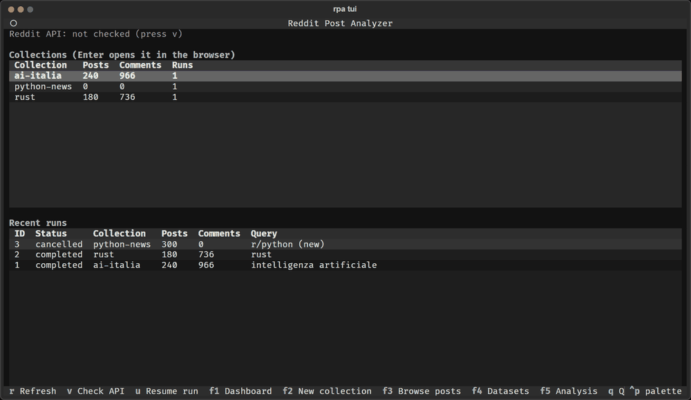

> Tutti gli screenshot e le GIF di questa guida usano un piccolo **database demo sintetico**, non
> dati reali di Reddit.

## Indice

1. [Cosa puoi fare](#cosa-puoi-fare)
2. [Installazione](#installazione)
3. [Guida passo passo](#guida-passo-passo)
   - [1. Collega il tuo account Reddit](#1-collega-il-tuo-account-reddit)
   - [2. Raccogli i post](#2-raccogli-i-post)
   - [3. Guarda cosa hai raccolto](#3-guarda-cosa-hai-raccolto)
   - [4. Analizza](#4-analizza)
   - [5. Costruisci un dataset da una ricetta](#5-costruisci-un-dataset-da-una-ricetta)
   - [6. Esporta](#6-esporta)
4. [Le tre interfacce](#le-tre-interfacce)
   - [Riga di comando](#riga-di-comando-rpa)
   - [Interfaccia da terminale](#interfaccia-da-terminale-rpa-tui)
   - [Interfaccia web](#interfaccia-web-rpa-gui)
5. [Le ricette nel dettaglio](#le-ricette-nel-dettaglio)
6. [Analyzer](#analyzer)
7. [Script e automazione](#script-e-automazione)
8. [Dove sono i dati e configurazione](#dove-sono-i-dati-e-configurazione)
9. [Problemi comuni e FAQ](#problemi-comuni-e-faq)
10. [Disclaimer](#disclaimer) · [Contribuire e licenza](#contribuire-e-licenza)

## Cosa puoi fare

| Vuoi... | Comando |
|---|---|
| cercare su Reddit e salvare post (e commenti) | `rpa collect search "rust" -s programming -n 500 --comments` |
| leggere la lista di un subreddit | `rpa collect subreddit italy --sort top -t year -n 1000` |
| riprendere una raccolta interrotta | `rpa runs resume <id>` |
| vedere cosa hai | `rpa collections list`, `rpa tui`, `rpa gui` |
| statistiche, parole chiave, lingua, sentiment | `rpa analyze <collection>` |
| costruire un dataset filtrato, pulito, diviso | `rpa dataset build recipes/examples/ai-italia.yaml` |
| esportare una collection intera | `rpa export <collection> --format jsonl` |

- **Tutto resta sul tuo computer**, in un solo file SQLite. Non servono account, server o cloud,
  a parte l'API di Reddit.
- **Riprendibile e incrementale.** Una raccolta che si ferma (Ctrl+C, rete, rate limit) riparte da
  dove era arrivata. Lo stesso post trovato da due ricerche è salvato una volta sola e appartiene a
  entrambe le collection.
- **I dataset sono ricette.** Un file YAML descrive filtri, pulizia del testo, deduplica e uno
  split opzionale. Stessa ricetta e stesso database danno lo stesso output, byte per byte, con un
  `dataset_card.md` che lo documenta.
- **Gli analyzer sono plugin.** I risultati sono salvati: TUI e GUI li mostrano senza ricalcolare.
  Puoi scriverne di tuoi.
- **Leggero.** SQLite e poche dipendenze; le parti pesanti sono extra opzionali.

## Installazione

Serve Python 3.11 o più recente.

```bash
pip install "reddit-post-analyzer[tui,gui,nlp]"
```

Core e comando `rpa` sono sempre inclusi. Gli extra sono opzionali:

| Extra | Aggiunge |
|---|---|
| *(nessuno)* | core, database SQLite, ricette, export CSV/JSONL e CLI |
| `tui` | `rpa tui`, l'interfaccia da terminale (Textual) |
| `gui` | `rpa gui`, l'interfaccia web (Streamlit, Plotly) |
| `nlp` | rilevamento della lingua e sentiment (`langdetect`, `vaderSentiment`) |
| `parquet` | export Parquet |
| `hf` | export Hugging Face `datasets` (solo formato locale) |

Verifica con `rpa --version`. Se un comando richiede un extra che non hai installato, ti dice la
riga `pip install` esatta da lanciare.

<details>
<summary>Installazione da sorgente (per contribuire)</summary>

```bash
git clone https://github.com/danieleavolio/RedditTool && cd RedditTool
uv sync --all-extras
uv run pytest
```

</details>

## Guida passo passo

### 1. Collega il tuo account Reddit

Il tool **non include chiavi API**: usi la tua app Reddit (tipo *web app* o *installed app*,
redirect URI esattamente `http://localhost:8080`). La procedura completa, e cosa fare se non hai
un'app, è in [docs/reddit-credentials.md](docs/reddit-credentials.md) (in inglese).

```bash
rpa auth login     # chiede client ID e secret, poi apre il browser per autorizzare
rpa auth test      # mostra il tuo utente Reddit e il rate limit rimasto
rpa auth logout    # revoca il token e lo toglie dal keyring
```

Client secret e refresh token vanno nel **keyring di sistema**, mai in un file di testo. Su un
server senza keyring o in CI usa le variabili `RPA_CLIENT_ID`, `RPA_CLIENT_SECRET` e
`RPA_REFRESH_TOKEN`.

> Tutto quello che segue funziona anche su dati che hai già: puoi esplorare il tool senza
> credenziali se esiste un database (per esempio importato con `rpa db import-legacy <file.db>`).

### 2. Raccogli i post

Ci sono due modi: **cercare** per parole chiave oppure **leggere la lista di un subreddit**.

```bash
# cerca su tutto Reddit, o solo in alcuni subreddit, scaricando anche i commenti
rpa collect search "rust" -s programming -s rust --sort top -t month -n 500 --comments

# oppure leggi un subreddit: hot, new, top, rising o controversial
rpa collect subreddit italy --sort top -t year -n 1000
```

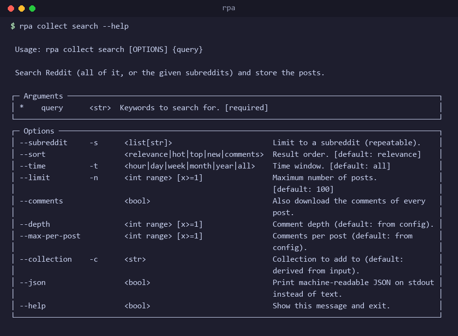

Opzioni utili:

| Opzione | Significato |
|---|---|
| `-s`, `--subreddit` | limita la ricerca a un subreddit (ripetibile) |
| `--sort` | ordine dei risultati (`relevance`, `hot`, `top`, `new`, `comments` nella ricerca) |
| `-t`, `--time` | finestra temporale: `hour`, `day`, `week`, `month`, `year`, `all` |
| `-n`, `--limit` | numero massimo di post |
| `--comments` | scarica anche i commenti di ogni post |
| `--depth`, `--max-per-post` | profondità e numero di commenti per post |
| `-c`, `--collection` | nome della collection (default: ricavato dall'input) |

I post finiscono in una **collection**. Reddit restituisce circa 1000 elementi per lista: per
andare oltre, combina più ordinamenti e finestre temporali nella stessa collection con `-c`.

**Se una raccolta si ferma** (Ctrl+C, errore di rete, rate limit) non perdi niente:

```bash
rpa runs list          # mostra ogni raccolta e il suo stato
rpa runs resume 3      # riprende la raccolta 3 dall'ultima pagina salvata
```

Puoi raccogliere anche dalla TUI (`F2`) o dall'interfaccia web (pagina *Collect*), con barra di
avanzamento e pulsante Cancel.

### 3. Guarda cosa hai raccolto

```bash
rpa collections list   # ogni collection con post e commenti
rpa runs list          # lo storico delle raccolte
```

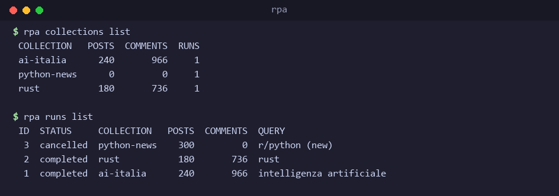

Per leggere i post con i loro commenti usa la TUI (`rpa tui`, tasto `F3`) o l'interfaccia web
(`rpa gui`, pagina *Explore*). Entrambe hanno ricerca full-text su titolo e testo e filtro per
subreddit. Vedi [le interfacce](#le-tre-interfacce).

### 4. Analizza

```bash
rpa analyze --list                        # cosa è disponibile e cosa richiede un extra
rpa analyze ai-italia                     # lancia tutti gli analyzer pronti
rpa analyze ai-italia -a keywords         # ne lancia uno (ripeti -a per più)
rpa analyze ai-italia --show              # mostra i risultati salvati, senza calcolare
```

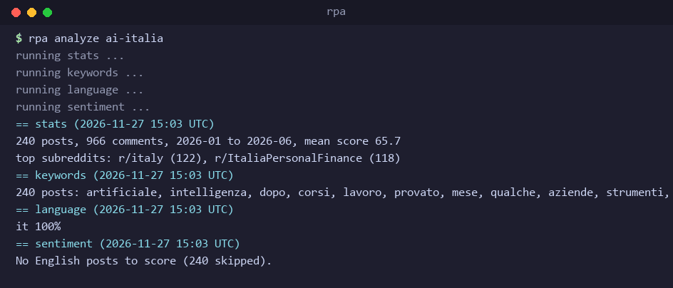

I risultati sono salvati nel database: la TUI (`F5`) e l'interfaccia web (pagina *Analysis*) li
mostrano subito. Dettagli in [Analyzer](#analyzer).

### 5. Costruisci un dataset da una ricetta

Una **ricetta** è un breve file YAML che seleziona e modella ciò che è già nel tuo database
locale. Non tocca mai la rete.

```yaml
name: ai-italia-2026
collection: ai-italia
search: "intelligenza artificiale"     # opzionale, ricerca full-text locale
unit: post                             # post | comment | pair

filters:
  subreddits: [italy, ItaliaPersonalFinance]
  min_score: 5
  after: 2026-01-01
  lang: it                             # richiede l'extra [nlp]
  exclude_removed: true
  exclude_bots: true
  min_chars: 40

transform:
  text: "{title}\n\n{selftext}"
  strip: [urls, markdown, usernames]
  dedup: exact                         # none | exact | near

split:                                 # opzionale, deterministico
  parts: { a: 0.8, b: 0.2 }
  seed: 42

output:
  format: jsonl                        # csv | jsonl | parquet | hf
  fields: [id, subreddit, created_utc, score, num_comments, text]
```

Prima controllala, poi costruiscila:

```bash
rpa dataset preview recipes/examples/ai-italia.yaml --n 20    # conteggi, righe scartate e perché, esempi
rpa dataset build recipes/examples/ai-italia.yaml             # scrive i file e dataset_card.md
```

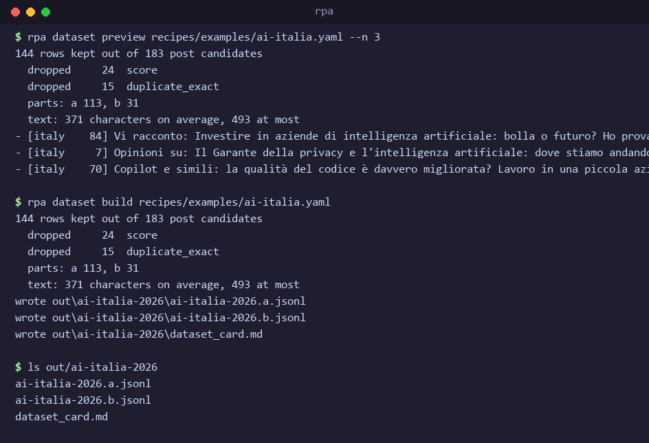

La cartella di output (`out/<nome>`, o quella data con `-o`) contiene i file dei dati e un
`dataset_card.md` con sorgente, filtri, conteggi, data e disclaimer. Gli errori in una ricetta
indicano il nome dell'opzione e cosa ci si aspettava. Puoi anche modificare le ricette con
**anteprima live** nella TUI (`F4`) e nell'interfaccia web (pagina *Dataset*).
Ogni opzione è spiegata in [Le ricette nel dettaglio](#le-ricette-nel-dettaglio).

### 6. Esporta

Per un dump semplice di un'intera collection, senza filtri:

```bash
rpa export rust --format csv                   # csv | jsonl | parquet | hf
rpa export rust --unit comment --format jsonl  # post, commenti o coppie post/risposta
rpa export rust -o mia-cartella                # cartella di default: out/<collection>
```

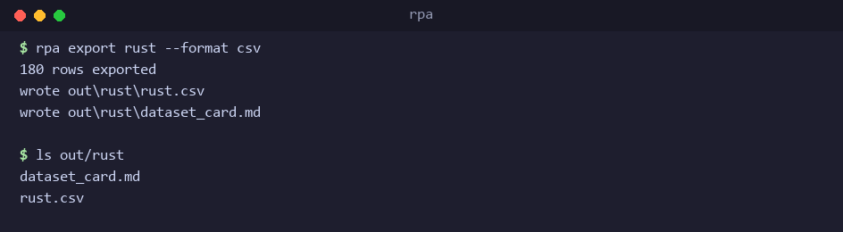

## Le tre interfacce

Sono tutte sottili strati sullo stesso core, quindi mostrano sempre gli stessi dati.

### Riga di comando (`rpa`)

Il modo più rapido per automatizzare. `rpa --help` elenca i comandi; ognuno ha `--help`.
Metti `--quiet` / `--verbose` **prima** del comando: `rpa -q runs list`.

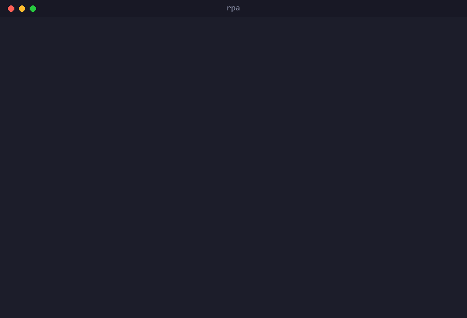

### Interfaccia da terminale (`rpa tui`)

Interfaccia a schermo intero che funziona anche via SSH. Tasti: `F1` dashboard, `F2` nuova
raccolta, `F3` browser dei post, `F4` editor di ricette, `F5` analisi, `Ctrl+P` command palette,
`Q` esci. Per usarla nel browser: `textual serve "rpa tui"`.

**Dashboard (`F1`)**: collection e raccolte recenti. `Invio` apre una collection nel browser,
`R` aggiorna, `V` controlla l'API di Reddit, `U` riprende la raccolta interrotta selezionata.

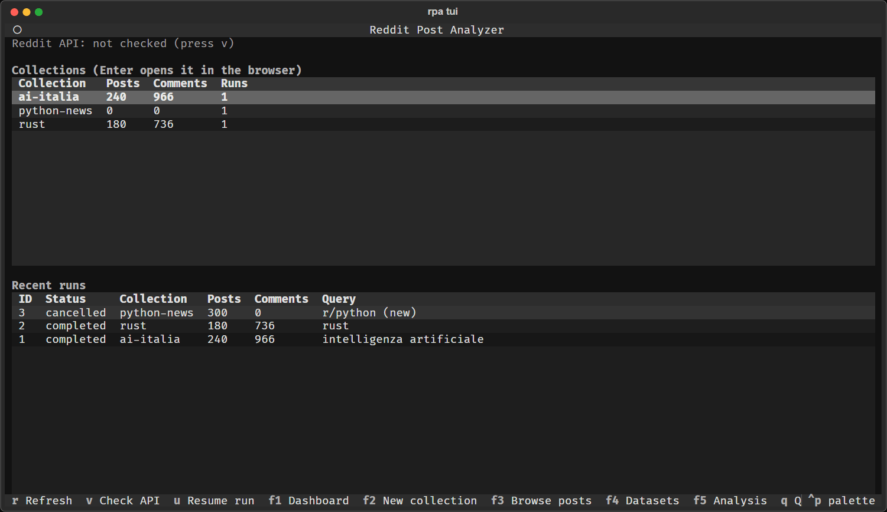

**Nuova raccolta (`F2`)**: compila il modulo e premi *Start*. Una barra di avanzamento e un log
seguono la raccolta; *Cancel* la ferma in modo pulito e potrai riprenderla.

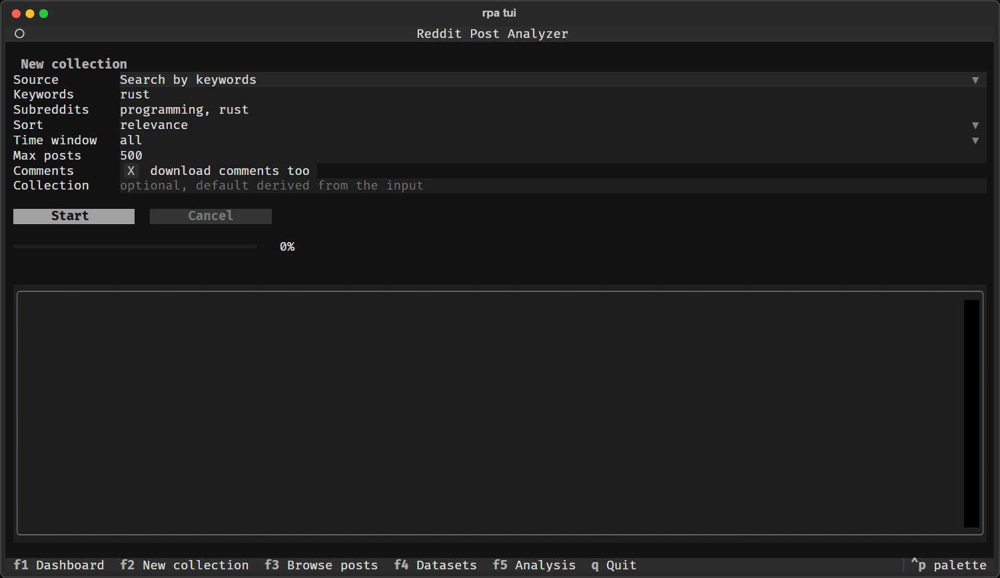

**Browser dei post (`F3`)**: scegli una collection, cerca nel testo (`Invio`), filtra per subreddit,
muoviti con le frecce e leggi il post con i commenti a destra.

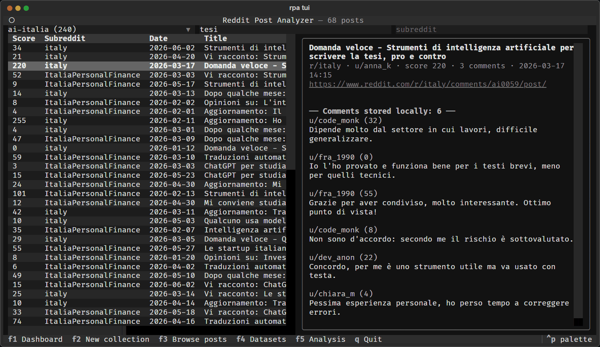

**Editor di ricette (`F4`)**: modifica lo YAML a sinistra, l'anteprima a destra si aggiorna mentre
scrivi (righe tenute, scartate e perché, esempi). `Ctrl+B` costruisce, `Ctrl+S` salva.

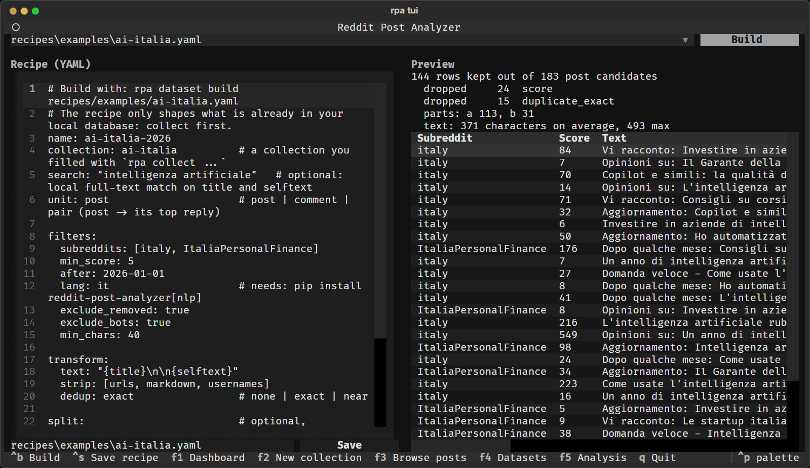

**Analisi (`F5`)**: post per mese, subreddit, autori e parole più frequenti, più i risultati salvati
degli altri analyzer. `A` li calcola.

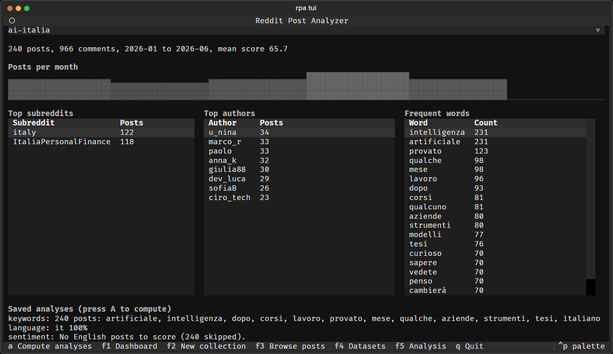

### Interfaccia web (`rpa gui`)

Si apre nel browser su <http://localhost:8501> (cambia porta con `--port`). Gira tutto sul tuo
computer.

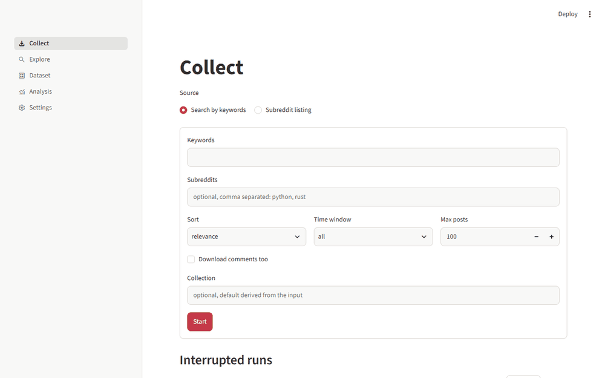

**Collect**: scegli ricerca o lista di un subreddit, compila i campi, avvia. Le raccolte interrotte
hanno il pulsante *Resume*.

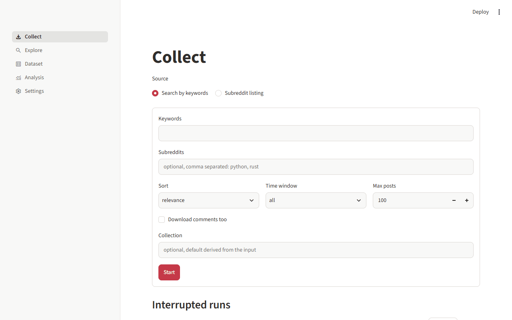

**Explore**: ricerca full-text nel tuo database. Clicca una riga per leggere il post e i commenti.

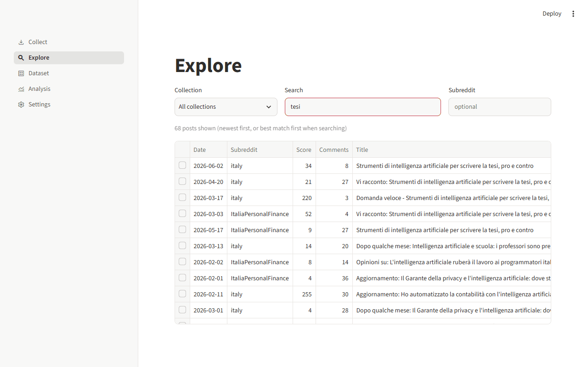
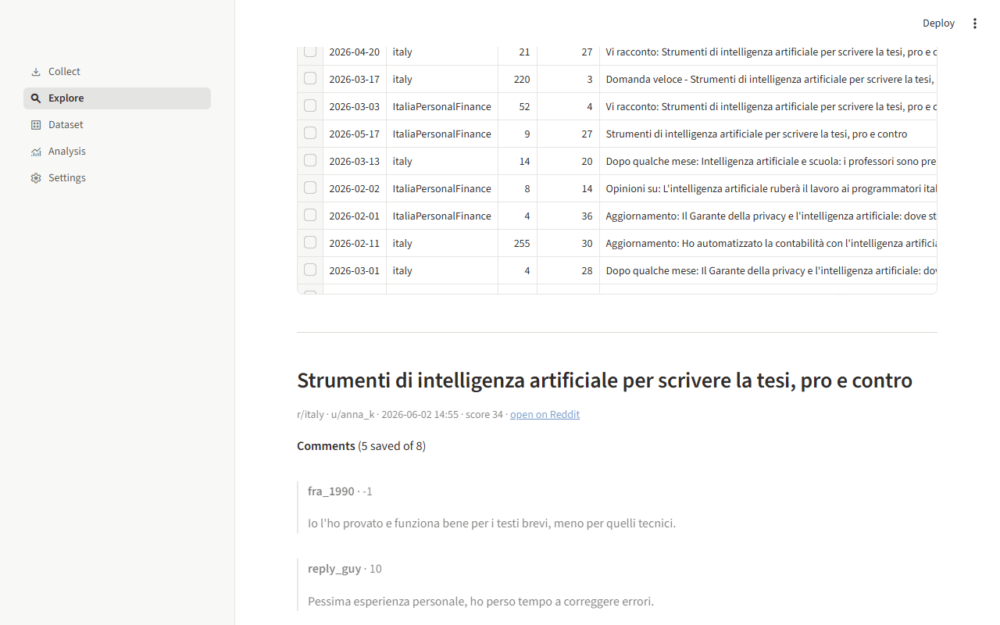

**Dataset**: scegli o scrivi una ricetta, guarda l'anteprima aggiornarsi, costruisci e scarica i file.

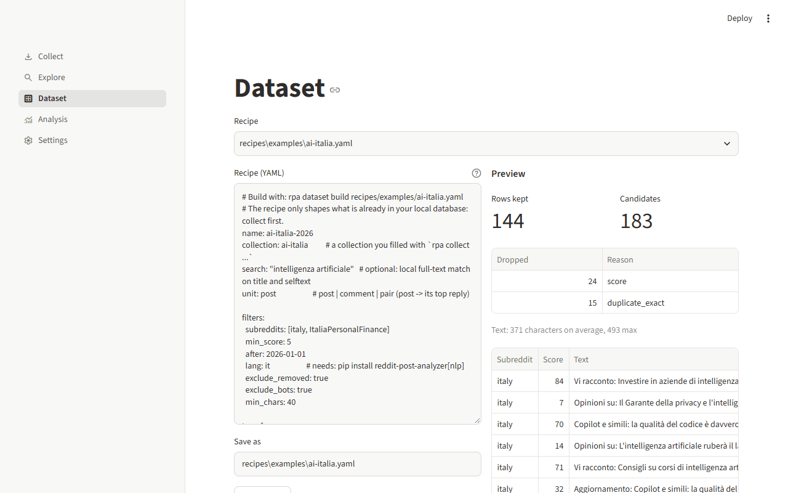

**Analysis**: conteggi, classifiche, mappa di attività e risultati salvati degli analyzer (parole
chiave, lingua, sentiment), ciascuno con un pulsante *Compute* / *Recompute*.

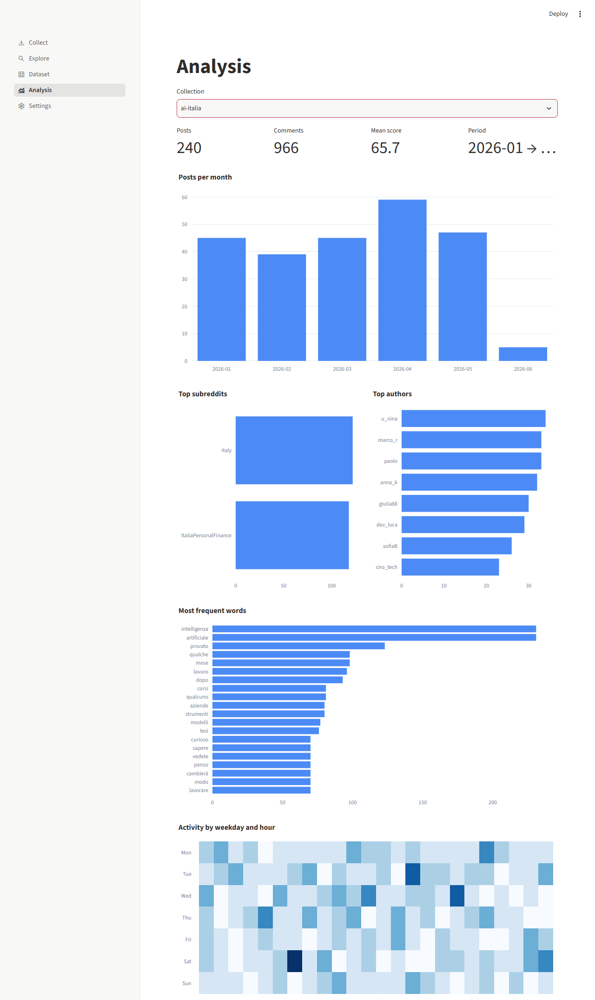

La pagina **Settings** mostra se le credenziali sono impostate (mai il secret), dove sono i file e
i valori predefiniti della raccolta.

## Le ricette nel dettaglio

| Sezione | Opzione | Significato |
|---|---|---|
| livello base | `name` | lettere minuscole, cifre, `-` e `_` |
| | `collection` | la collection da cui leggere |
| | `search` | ricerca full-text locale opzionale su titolo e testo |
| | `unit` | le righe sono `post`, `comment` o `pair` (un post e la sua risposta migliore) |
| `filters` | `min_score`, `max_score` | intervallo di punteggio |
| | `after` (incluso), `before` (escluso) | date; una data sola significa 00:00 UTC |
| | `subreddits`, `exclude_authors` | liste, senza distinzione maiuscole/minuscole |
| | `lang` | codici ISO, es. `[it, en]` (richiede `[nlp]`) |
| | `exclude_removed` | default `true`: il contenuto `[removed]` non è mai un dato |
| | `nsfw` | `include` (default), `exclude`, `only` |
| | `min_chars`, `max_chars` | misurati sul testo pulito |
| | `exclude_bots` | AutoModerator e autori chiamati `*bot` / `*_bot` |
| `transform` | `text` | template con i campi dell'unità, es. `{title}` e `{selftext}` |
| | `strip` | uno tra `urls`, `markdown`, `usernames` |
| | `normalize_whitespace` | default `true` |
| | `dedup` | `none`, `exact` (hash) o `near` (MinHash, soglia `near_threshold`) |
| `split` | `parts`, `seed` | le quote sommano a 1; deterministico; un thread non attraversa mai le parti |
| `output` | `format`, `fields` | `csv`, `jsonl`, `parquet` o `hf`; i default dipendono dall'unità |

Altro in [docs/recipes.md](docs/recipes.md). Un esempio pronto è in
[recipes/examples/ai-italia.yaml](recipes/examples/ai-italia.yaml).

## Analyzer

| Nome | Richiede | Cosa dà |
|---|---|---|
| `stats` | | conteggi, post per mese, subreddit e autori principali, attività per giorno e ora |
| `keywords` | | parole che caratterizzano la collection (TF-IDF, un documento per post) |
| `language` | `[nlp]` | lingua di ogni post, salvata sul post (la usano i filtri `lang` dei dataset) |
| `sentiment` | `[nlp]` | sentiment VADER dei soli post **in inglese** (le altre lingue sono saltate, non valutate male) |

Puoi scriverne di tuoi e registrarli come entry point: vedi [docs/analyzers.md](docs/analyzers.md).

## Script e automazione

Ogni comando accetta `--json` e stampa output leggibile da macchina su stdout:

```bash
rpa collections list --json
rpa collect search "rust" -s programming -n 200 --json
```

Codici di uscita: `0` ok · `1` altro errore · `2` errore d'uso · `3` credenziali mancanti o
rifiutate · `4` Reddit non raggiungibile o rate limit · `130` interrotto. Comodo per cron, CI e
script di shell (per esempio: riprova su `4`, avvisa su `3`).

## Dove sono i dati e configurazione

I dati sono nella cartella dati del tuo utente: `reddit.db` (il database) e `config.toml`. La
pagina *Settings* dell'interfaccia web mostra i percorsi esatti. Le impostazioni si leggono, in
ordine di priorità, dalle variabili d'ambiente `RPA_*`, poi da `config.toml`, poi dai default.

| Variabile | Significato |
|---|---|
| `RPA_DATA_DIR` | metti il database altrove |
| `RPA_CONFIG_FILE` | usa un altro `config.toml` |
| `RPA_CLIENT_ID`, `RPA_CLIENT_SECRET`, `RPA_REFRESH_TOKEN`, `RPA_REDIRECT_URI` | credenziali senza keyring |

Per ricominciare da zero o tenere progetti separati, punta `RPA_DATA_DIR` a un'altra cartella.
Per il backup copia `reddit.db`.

## Problemi comuni e FAQ

**`rpa tui` / `rpa gui` dice che manca un extra.** Installalo:
`pip install "reddit-post-analyzer[tui]"` oppure `[gui]`.

**Codice 3, "credenziali mancanti o rifiutate".** Rilancia `rpa auth login`, poi `rpa auth test`.
Controlla che il redirect URI sia esattamente `http://localhost:8080`.

**Codice 4 o la raccolta è lenta.** Reddit ti ha limitato o non è raggiungibile. Il tool rallenta da
solo; se si ferma, lancia `rpa runs resume <id>`.

**Ho solo circa 1000 post.** È un limite di Reddit per ogni lista. Combina più valori di `--sort`
e `--time` nella stessa collection con `-c`.

**Il filtro `lang:` o il sentiment non fanno nulla.** Richiedono l'extra `[nlp]`, e il sentiment
valuta solo i post in inglese.

**Sul mio server non c'è il keyring.** Usa le variabili d'ambiente `RPA_*` elencate sopra.

**Posso usarlo senza credenziali Reddit?** Non c'è una modalità anonima (andrebbe contro le regole
di Reddit). Puoi comunque esplorare i dati che hai già in un database.

## Disclaimer

Reddit Post Analyzer è uno strumento per **scaricare, organizzare ed esplorare** in locale
contenuti di Reddit. Non è pensato né destinato all'addestramento di modelli di machine
learning o AI.

- Il progetto non è affiliato, approvato o sponsorizzato da Reddit, Inc.
- Devi usare le tue credenziali API Reddit, approvate da Reddit, e rispettare User Agreement,
  Developer Terms, Data API Terms e Responsible Builder Policy di Reddit.
- Usare i dati di Reddit per addestrare modelli ML/AI, o per qualsiasi scopo commerciale,
  richiede un'approvazione scritta di Reddit. Ottenerla è una tua responsabilità.
- Il progetto non distribuisce dati di Reddit. Non ridistribuire i dataset creati con il
  tool se non ne hai il permesso.
- Rispetta la privacy degli utenti: elimina i contenuti rimossi da Reddit e non cercare di
  identificare le persone.

Il software è fornito "così com'è", senza garanzie. Gli autori non sono responsabili
dell'uso che ne viene fatto.

> **Stato dell'API Reddit.** Reddit ha smesso di accettare nuove richieste di accesso alla Data
> API il 31 ottobre 2026 e prevede di chiudere l'accesso pubblico residuo a marzo 2027. Se hai già
> un'app approvata il tool funziona finché Reddit la tiene attiva. Verifica il tuo accesso prima
> di farci affidamento.

## Contribuire e licenza

I contributi sono benvenuti: vedi [CONTRIBUTING.md](CONTRIBUTING.md). Rilasciato sotto
[Licenza MIT](LICENSE).
