# Reddit Post Analyzer

[](https://github.com/danieleavolio/RedditTool/actions/workflows/ci.yml)
[](LICENSE)

**Collect Reddit posts and comments into a local database, explore them, analyze them and turn
them into clean, reproducible datasets.** Use it from the command line, from a terminal UI or from
a web UI: one core, three interfaces.

Italiano: [README.it.md](README.it.md) · Docs: <https://danieleavolio.github.io/RedditTool/>

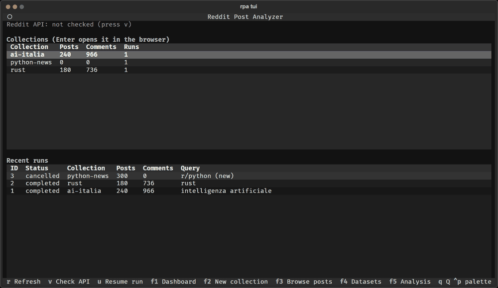

> All screenshots and GIFs in this guide use a small **synthetic demo database**, not real Reddit
> data.

## Contents

1. [What you can do with it](#what-you-can-do-with-it)
2. [Install](#install)
3. [Step by step guide](#step-by-step-guide)
   - [1. Connect your Reddit account](#1-connect-your-reddit-account)
   - [2. Collect posts](#2-collect-posts)
   - [3. Look at what you collected](#3-look-at-what-you-collected)
   - [4. Analyze it](#4-analyze-it)
   - [5. Build a dataset from a recipe](#5-build-a-dataset-from-a-recipe)
   - [6. Export](#6-export)
4. [The three interfaces](#the-three-interfaces)
   - [Command line](#command-line-rpa)
   - [Terminal UI](#terminal-ui-rpa-tui)
   - [Web UI](#web-ui-rpa-gui)
5. [Recipes in detail](#recipes-in-detail)
6. [Analyzers](#analyzers)
7. [Scripting and automation](#scripting-and-automation)
8. [Where your data lives and configuration](#where-your-data-lives-and-configuration)
9. [Troubleshooting and FAQ](#troubleshooting-and-faq)
10. [Disclaimer](#disclaimer) · [Contributing and license](#contributing-and-license)

## What you can do with it

| You want to... | Command |
|---|---|
| search Reddit and save posts (and comments) | `rpa collect search "rust" -s programming -n 500 --comments` |
| read a subreddit listing | `rpa collect subreddit italy --sort top -t year -n 1000` |
| continue a collection that was interrupted | `rpa runs resume <id>` |
| see what you have | `rpa collections list`, `rpa tui`, `rpa gui` |
| get statistics, keywords, language, sentiment | `rpa analyze <collection>` |
| build a filtered, cleaned, split dataset | `rpa dataset build recipes/examples/ai-italia.yaml` |
| export a whole collection | `rpa export <collection> --format jsonl` |

- **Everything stays on your computer** in one SQLite file. No account, server or cloud needed
  apart from the Reddit API itself.
- **Resumable and incremental.** A collection that stops (Ctrl+C, network, rate limit) continues
  where it stopped. The same post found by two searches is stored once and belongs to both
  collections.
- **Datasets are recipes.** A YAML file describes filters, text cleaning, deduplication and an
  optional split. The same recipe on the same database gives the same output, byte for byte, and
  writes a `dataset_card.md` that documents it.
- **Analyzers are plugins.** Results are stored, so the TUI and the web UI show them without
  recomputing. You can write your own.
- **Light.** SQLite and a few dependencies; the heavy parts are optional extras.

## Install

You need Python 3.11 or newer. The package is not on PyPI yet, so install it straight from GitHub.
The recommended way is [uv](https://docs.astral.sh/uv/), on Windows, macOS and Linux:

```bash
uv tool install "reddit-post-analyzer[tui,gui,nlp] @ git+https://github.com/danieleavolio/RedditTool"
```

This puts the `rpa` command on your PATH. Open a **new terminal** and run `rpa --version`.
To update later: `uv tool upgrade reddit-post-analyzer`.

Prefer pip? `pip install "reddit-post-analyzer[tui,gui,nlp] @ git+https://github.com/danieleavolio/RedditTool"`
works too, but on Windows the `rpa` command may not be found because pip's `Scripts` folder is not
on your PATH. In that case run it as `python -m reddit_analyzer` (same arguments as `rpa`).

The core and the `rpa` command are always included. The extras are opt-in:

| Extra | Adds |
|---|---|
| *(none)* | core, SQLite storage, recipes, CSV/JSONL export and the CLI |
| `tui` | `rpa tui`, the terminal UI (Textual) |
| `gui` | `rpa gui`, the web UI (Streamlit, Plotly) |
| `nlp` | language detection and sentiment (`langdetect`, `vaderSentiment`) |
| `parquet` | Parquet export |
| `hf` | Hugging Face `datasets` export (local format only) |

Check it worked with `rpa --version`. If a command needs an extra you did not install, add it to
the install command above (for example `[tui]`).

<details>
<summary>Install from source (to contribute)</summary>

```bash
git clone https://github.com/danieleavolio/RedditTool && cd RedditTool
uv sync --all-extras
uv run pytest
uv run rpa --help        # run the tool from the checkout, without installing it
```

</details>

## Step by step guide

### 1. Connect your Reddit account

The tool ships **no API keys**: you use your own Reddit app (type *web app* or *installed app*,
redirect URI exactly `http://localhost:8080`). The full walkthrough, and what to do if you do not
have an app, is in [docs/reddit-credentials.md](docs/reddit-credentials.md).

```bash
rpa auth login     # asks for client ID and secret, then opens your browser to authorize
rpa auth test      # shows your Reddit user and the remaining rate limit
rpa auth logout    # revokes the token and removes it from your keyring
```

The client secret and refresh token go in your **system keyring**, never in a plain text file.
On a headless machine or in CI, use the `RPA_CLIENT_ID`, `RPA_CLIENT_SECRET` and
`RPA_REFRESH_TOKEN` environment variables instead.

> Everything after this step also works on data you already have, so you can explore the tool
> without credentials once a database exists (for example one imported with
> `rpa db import-legacy <file.db>`).

### 2. Collect posts

There are two ways to collect: **search** by keywords, or **read a subreddit listing**.

```bash
# search all of Reddit, or only inside some subreddits, and download the comments too
rpa collect search "rust" -s programming -s rust --sort top -t month -n 500 --comments

# or read a subreddit: hot, new, top, rising or controversial
rpa collect subreddit italy --sort top -t year -n 1000
```

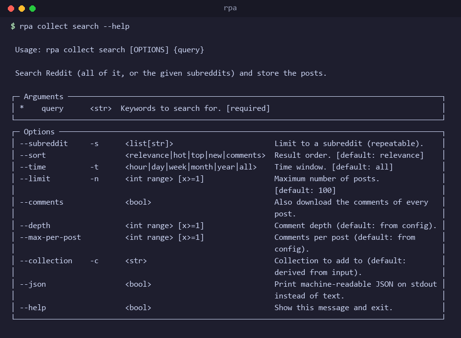

Useful options:

| Option | Meaning |
|---|---|
| `-s`, `--subreddit` | limit a search to a subreddit (repeat it for more) |
| `--sort` | result order (`relevance`, `hot`, `top`, `new`, `comments` for search) |
| `-t`, `--time` | time window: `hour`, `day`, `week`, `month`, `year`, `all` |
| `-n`, `--limit` | maximum number of posts |
| `--comments` | also download the comments of every post |
| `--depth`, `--max-per-post` | how deep and how many comments per post |
| `-c`, `--collection` | name of the collection to add to (default: derived from your input) |

Posts go into a **collection**. Reddit returns about 1000 items per listing, so to go further
combine several sorts and time windows into the same collection with `-c`.

**If a run stops** (Ctrl+C, network error, rate limit) nothing is lost:

```bash
rpa runs list          # shows every run and its status
rpa runs resume 3      # continues run 3 from the last saved page
```

You can also collect from the terminal UI (`F2`) or the web UI (*Collect* page), with a progress
bar and a Cancel button.

### 3. Look at what you collected

```bash
rpa collections list   # every collection with its posts and comments
rpa runs list          # the history of your runs
```

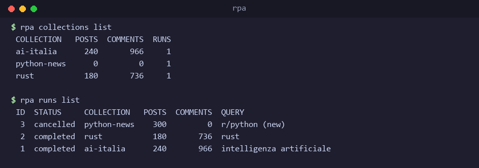

To read the posts and their comments, use the terminal UI (`rpa tui`, key `F3`) or the web UI
(`rpa gui`, *Explore* page). Both have full-text search over title and body, and a subreddit
filter. See [the interfaces](#the-three-interfaces).

### 4. Analyze it

```bash
rpa analyze --list                        # what is available and what needs an extra
rpa analyze ai-italia                     # run every analyzer that is ready
rpa analyze ai-italia -a keywords         # run one (repeat -a for more)
rpa analyze ai-italia --show              # print what is stored, compute nothing
```

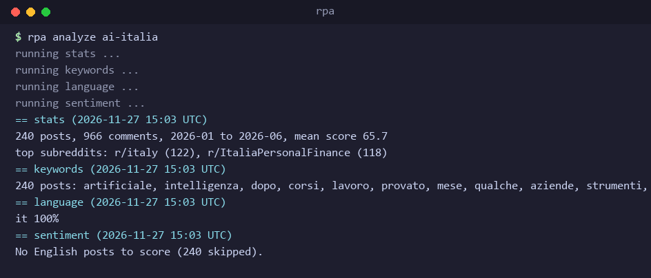

Results are saved in the database, so the TUI (`F5`) and the web UI (*Analysis* page) display
them instantly. More in [Analyzers](#analyzers).

### 5. Build a dataset from a recipe

A **recipe** is a short YAML file that selects and shapes what is already in your local database.
It never touches the network.

```yaml
name: ai-italia-2026
collection: ai-italia
search: "intelligenza artificiale"     # optional local full-text match
unit: post                             # post | comment | pair

filters:
  subreddits: [italy, ItaliaPersonalFinance]
  min_score: 5
  after: 2026-01-01
  lang: it                             # needs the [nlp] extra
  exclude_removed: true
  exclude_bots: true
  min_chars: 40

transform:
  text: "{title}\n\n{selftext}"
  strip: [urls, markdown, usernames]
  dedup: exact                         # none | exact | near

split:                                 # optional, deterministic
  parts: { a: 0.8, b: 0.2 }
  seed: 42

output:
  format: jsonl                        # csv | jsonl | parquet | hf
  fields: [id, subreddit, created_utc, score, num_comments, text]
```

Check it first, then build it:

```bash
rpa dataset preview recipes/examples/ai-italia.yaml --n 20    # counts, dropped rows and why, samples
rpa dataset build recipes/examples/ai-italia.yaml             # writes the files and dataset_card.md
```

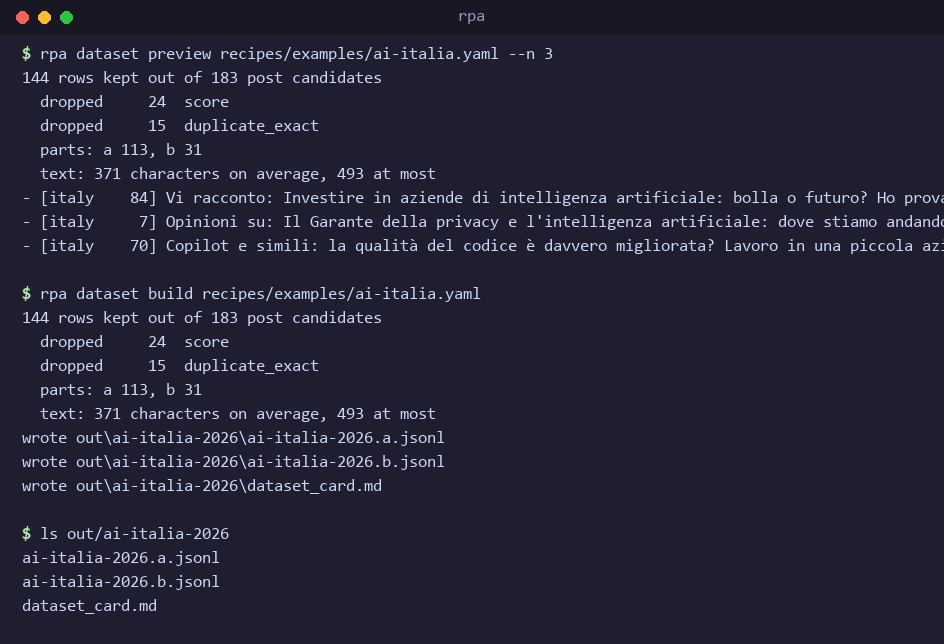

The output folder (`out/<name>` unless you pass `-o`) holds the data files and a
`dataset_card.md` with the source, the filters, the counts, the date and the disclaimer.
Mistakes in a recipe are reported with the option name and what was expected. You can also edit
recipes with a **live preview** in the TUI (`F4`) and in the web UI (*Dataset* page).
Every option is explained in [Recipes in detail](#recipes-in-detail).

### 6. Export

For a plain dump of a whole collection, without filters:

```bash
rpa export rust --format csv                   # csv | jsonl | parquet | hf
rpa export rust --unit comment --format jsonl  # posts, comments or post/reply pairs
rpa export rust -o my-folder                   # default folder: out/<collection>
```

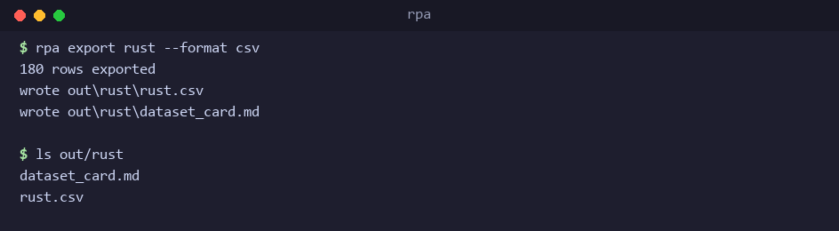

## The three interfaces

All three are thin layers over the same core, so they always show the same data.

### Command line (`rpa`)

The fastest way to automate things. `rpa --help` lists the commands; every command has `--help`.
Put `--quiet` / `--verbose` **before** the command: `rpa -q runs list`.


### Terminal UI (`rpa tui`)

A full-screen interface that works over SSH too. Keys: `F1` dashboard, `F2` new collection,
`F3` post browser, `F4` recipe editor, `F5` analysis, `Ctrl+P` command palette, `Q` quit. To use it
from a browser: `textual serve "rpa tui"`.

**Dashboard (`F1`)**: your collections and recent runs. `Enter` opens a collection in the browser,
`R` refreshes, `V` checks the Reddit API, `U` resumes the selected interrupted run.

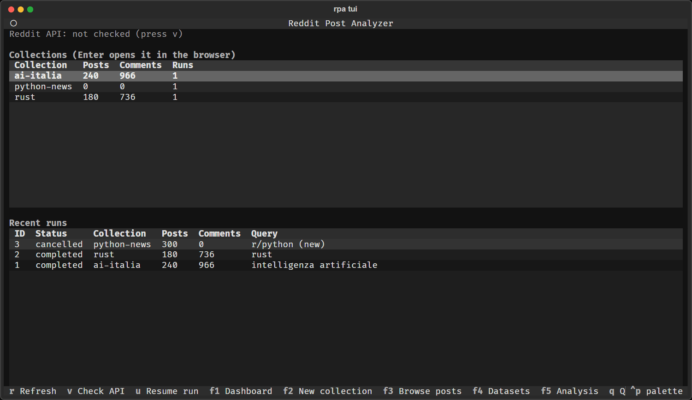

**New collection (`F2`)**: fill the form and press *Start*. A progress bar and a log follow the run;
*Cancel* stops it cleanly and the run can be resumed later.

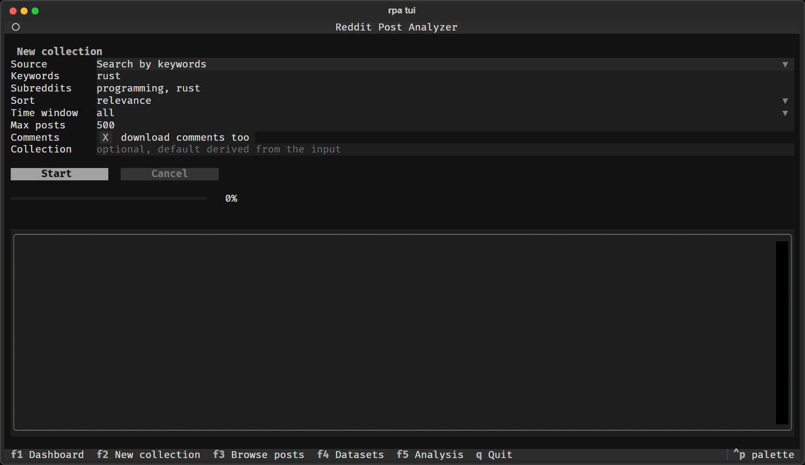

**Post browser (`F3`)**: pick a collection, search the text (`Enter`), filter by subreddit, move
with the arrow keys and read the post with its comments on the right.

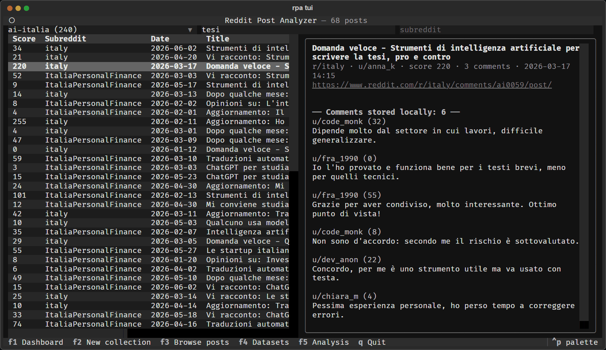

**Recipe editor (`F4`)**: edit the YAML on the left, the preview on the right updates as you type
(rows kept, rows dropped and why, samples). `Ctrl+B` builds, `Ctrl+S` saves.

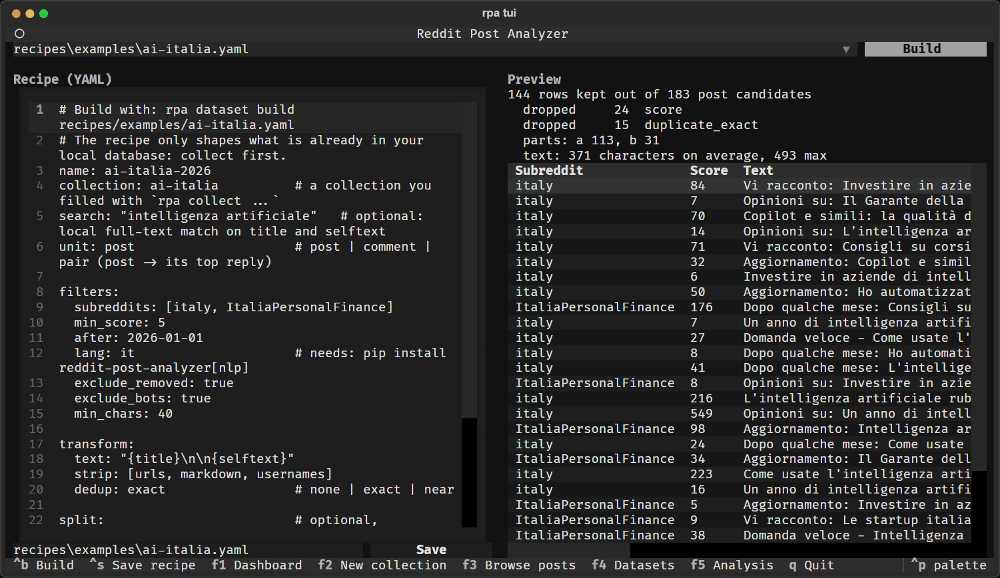

**Analysis (`F5`)**: posts per month, top subreddits, authors and words, plus the stored results of
the other analyzers. `A` computes them.

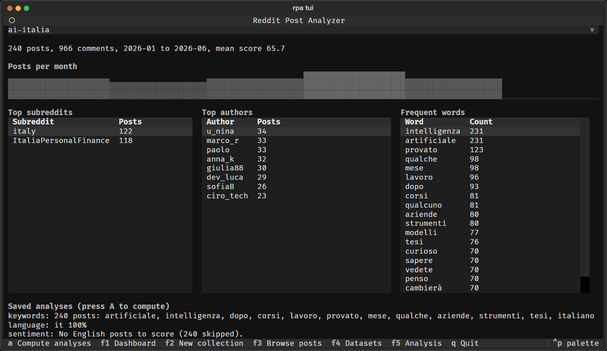

### Web UI (`rpa gui`)

Opens in your browser at <http://localhost:8501> (change it with `--port`). Everything runs on
your computer.

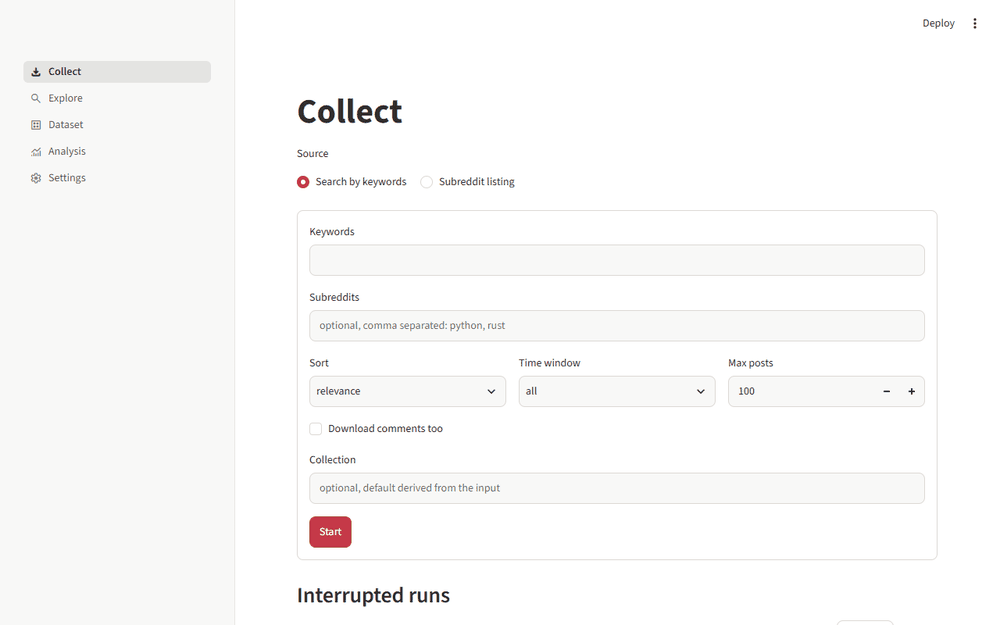

**Collect**: choose search or subreddit listing, fill the fields, start. Interrupted runs have a
*Resume* button.

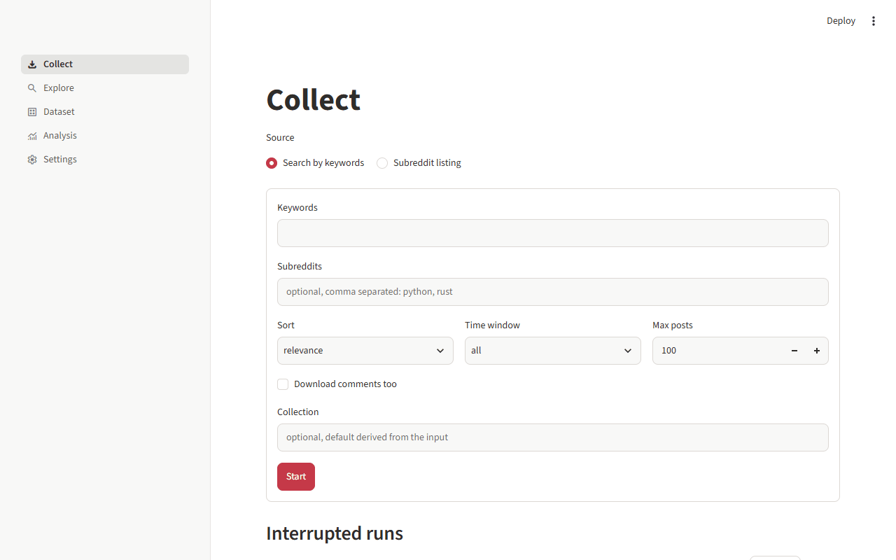

**Explore**: full-text search over your database. Click a row to read the post and its comments.

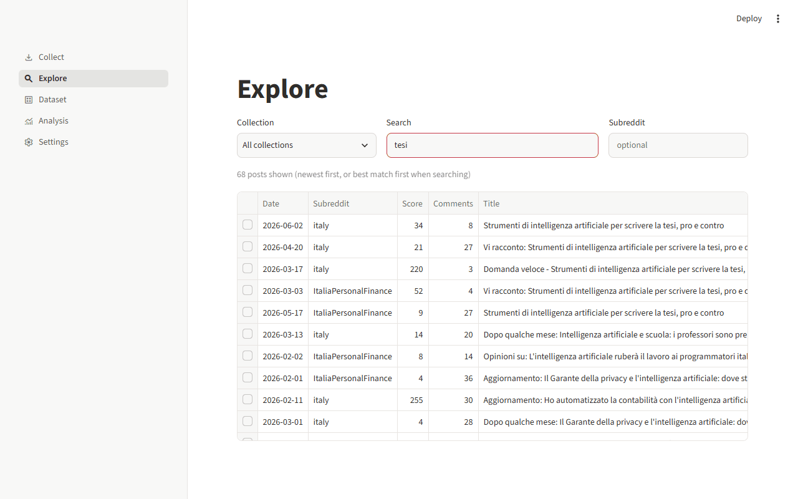
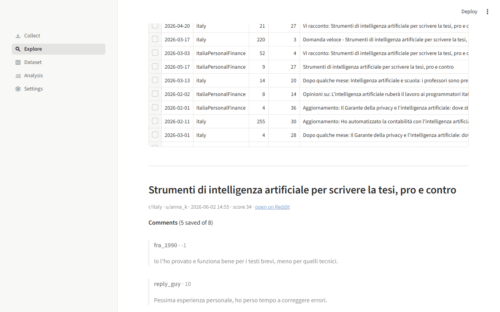

**Dataset**: pick or write a recipe, see the preview update, build it and download the files.

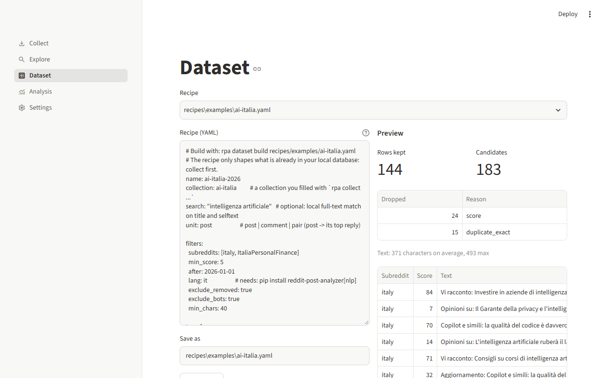

**Analysis**: counts, rankings, activity heatmap and the stored analyzer results (keywords,
language, sentiment), each with a *Compute* / *Recompute* button.

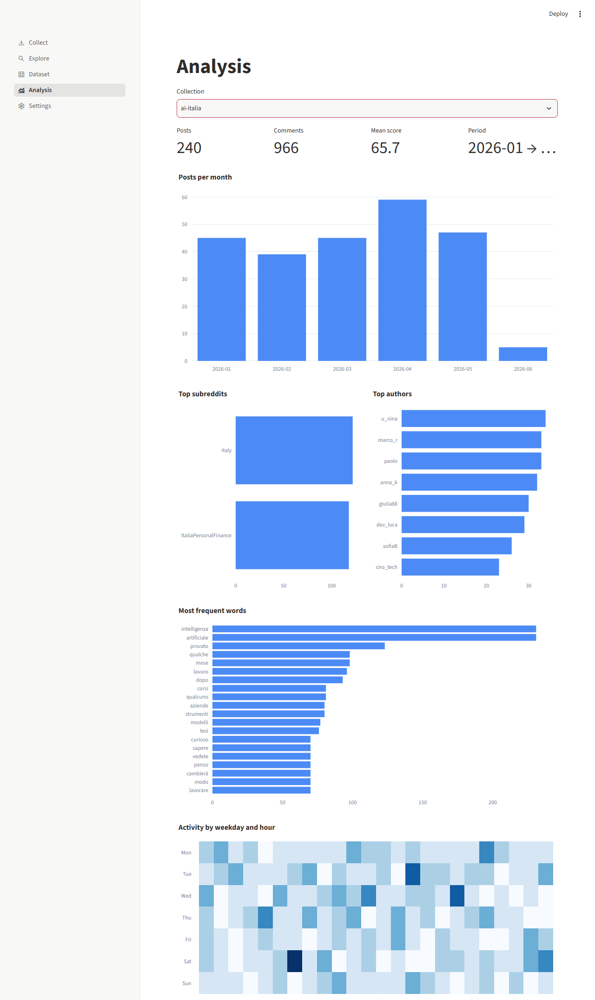

The **Settings** page shows whether credentials are set (never the secret), where your files
are, and the collection defaults.

## Recipes in detail

| Section | Option | Meaning |
|---|---|---|
| top level | `name` | lowercase letters, digits, `-` and `_` |
| | `collection` | the collection to read from |
| | `search` | optional local full-text match on title and body |
| | `unit` | rows are `post`s, `comment`s or `pair`s (a post and its top reply) |
| `filters` | `min_score`, `max_score` | score range |
| | `after` (inclusive), `before` (exclusive) | dates; a bare date means 00:00 UTC |
| | `subreddits`, `exclude_authors` | lists, case-insensitive |
| | `lang` | ISO codes, e.g. `[it, en]` (needs `[nlp]`) |
| | `exclude_removed` | default `true`: `[removed]` content is never data |
| | `nsfw` | `include` (default), `exclude`, `only` |
| | `min_chars`, `max_chars` | measured on the cleaned text |
| | `exclude_bots` | AutoModerator and authors named like `*bot` / `*_bot` |
| `transform` | `text` | template using the unit's fields, e.g. `{title}` and `{selftext}` |
| | `strip` | any of `urls`, `markdown`, `usernames` |
| | `normalize_whitespace` | default `true` |
| | `dedup` | `none`, `exact` (hash) or `near` (MinHash, threshold `near_threshold`) |
| `split` | `parts`, `seed` | shares must sum to 1; deterministic; a thread never crosses parts |
| `output` | `format`, `fields` | `csv`, `jsonl`, `parquet` or `hf`; defaults depend on the unit |

More in [docs/recipes.md](docs/recipes.md). A ready example is in
[recipes/examples/ai-italia.yaml](recipes/examples/ai-italia.yaml).

## Analyzers

| Name | Needs | What it gives |
|---|---|---|
| `stats` | | counts, posts per month, top subreddits and authors, activity by weekday and hour |
| `keywords` | | words that characterize the collection (TF-IDF, one document per post) |
| `language` | `[nlp]` | language of each post, saved on the post (dataset `lang` filters use it) |
| `sentiment` | `[nlp]` | VADER sentiment of **English** posts only (other languages are skipped, not mis-scored) |

You can write your own and register it as an entry point: see
[docs/analyzers.md](docs/analyzers.md).

## Scripting and automation

Every command accepts `--json` and prints machine-readable output on stdout:

```bash
rpa collections list --json
rpa collect search "rust" -s programming -n 200 --json
```

Exit codes: `0` ok · `1` other error · `2` usage error · `3` credentials missing or rejected ·
`4` Reddit unreachable or rate limited · `130` interrupted. That makes it easy to use in cron jobs,
CI or shell scripts (for example: retry on `4`, alert on `3`).

## Where your data lives and configuration

Your data is in your user data folder: `reddit.db` (the database) plus `config.toml`. The web UI
*Settings* page shows the exact paths. Settings are read, in order of priority, from `RPA_*`
environment variables, then `config.toml`, then defaults.

| Variable | Meaning |
|---|---|
| `RPA_DATA_DIR` | put the database somewhere else |
| `RPA_CONFIG_FILE` | use another `config.toml` |
| `RPA_CLIENT_ID`, `RPA_CLIENT_SECRET`, `RPA_REFRESH_TOKEN`, `RPA_REDIRECT_URI` | credentials without the keyring |

To start over or keep separate projects, point `RPA_DATA_DIR` at a different folder.
Back up by copying `reddit.db`.

## Troubleshooting and FAQ

**`rpa` is not recognized (Windows).** The `rpa` command is not on your PATH. Install with
`uv tool install` (see [Install](#install)) and open a new terminal, or run `python -m reddit_analyzer`
instead of `rpa`, or `uv run rpa` from a clone of the repository.

**`rpa tui` / `rpa gui` says an extra is missing.** Reinstall with that extra in the brackets,
for example `uv tool install --force "reddit-post-analyzer[tui,gui,nlp] @ git+https://github.com/danieleavolio/RedditTool"`.

**Exit code 3, "credentials missing or rejected".** Run `rpa auth login` again, then
`rpa auth test`. Check the redirect URI is exactly `http://localhost:8080`.

**Exit code 4 or the run is slow.** Reddit rate-limited you or is unreachable. The tool slows down
by itself; if it stops, run `rpa runs resume <id>`.

**I only got about 1000 posts.** That is a Reddit limit per listing. Combine several `--sort`
and `--time` values into the same collection with `-c`.

**The `lang:` filter or sentiment does nothing.** They need the `[nlp]` extra, and sentiment only
scores English posts.

**No keyring on my server.** Use the `RPA_*` environment variables listed above.

**Can I use it without Reddit credentials?** There is no anonymous mode (it would go against
Reddit's rules). You can still explore data you already have in a database.

## Disclaimer

Reddit Post Analyzer is a tool for **downloading, organizing and exploring** Reddit
content locally. It is not designed or intended for training machine learning or AI models.

- This project is not affiliated with, endorsed by, or sponsored by Reddit, Inc.
- You must use your own Reddit API credentials, approved by Reddit, and comply with
  Reddit's User Agreement, Developer Terms, Data API Terms and Responsible Builder Policy.
- Using Reddit data to train ML/AI models, or for any commercial purpose, requires
  express written approval from Reddit. Obtaining it is your responsibility.
- No Reddit data is distributed with this project. Do not redistribute datasets built
  with it unless you are allowed to.
- Respect users' privacy: delete content that has been removed from Reddit and do not
  try to identify individuals.

The software is provided "as is", without warranty. The authors are not responsible
for how it is used.

> **Status of Reddit's Data API.** Reddit stopped accepting new Data API access requests on
> 31 Oct 2026 and plans to end remaining public access in March 2027. If you already have an
> approved app the tool works for as long as Reddit keeps it active. Check your access before
> relying on this tool.

## Contributing and license

Contributions are welcome: see [CONTRIBUTING.md](CONTRIBUTING.md). Released under the
[MIT License](LICENSE).
