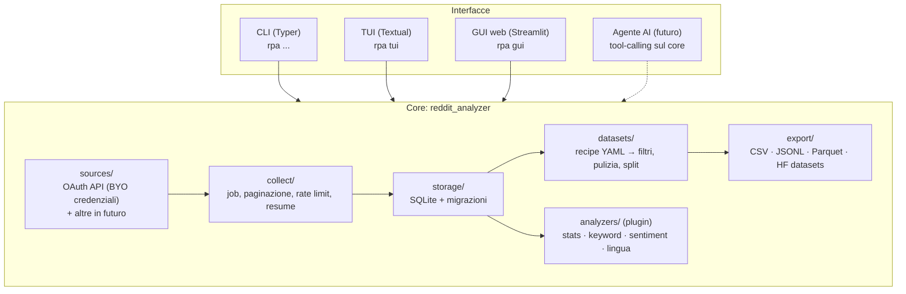

# Reddit Post Analyzer → suite open source: analisi e piano

> Stato: proposta, 27 nov 2026. Nessuna riga di codice è stata ancora cambiata.
> Ogni fase dice quale modello usare (Haiku / Sonnet) e con quale effort.

---

## 1. Da dove partiamo

### Cosa dice Search Console (ultimi 28 giorni)

| Metrica | Valore |
|---|---|
| Clic | 3 |
| Impressioni | 4 |
| CTR | 75% |
| Posizione media | 3,25 |
| Query principale | `reddit post analyzer` (2 clic, 2 impressioni, pos. 3) |

Questi numeri sono piccoli, quindi vanno letti come un segnale e non come una prova. Due cose però contano:
- quando la pagina esce nei risultati viene cliccata quasi sempre, quindi titolo e snippet funzionano;
- la query è **in inglese**. La pagina e la repo invece sono solo in italiano. Una README e una landing in inglese sono la leva più economica per far crescere le impressioni.

**Nome:** teniamo "Reddit Post Analyzer" come nome pubblico, perché è esattamente la query che già ti porta traffico.

### Il codice oggi (~900 righe, 6 file flat)

| File | Ruolo | Problemi principali |
|---|---|---|
| `scraper.py` | chiama `reddit.com/search.json` | User-Agent da browser finto (`scraper.py:27`), contro le regole Reddit. Nessun OAuth. Prende solo 6 campi (niente `created_utc`, autore, commenti, `num_comments`). Default `'N/A'` dentro i dati. Solo ricerca globale, niente subreddit/sort/time filter |
| `database.py` | SQLite | `post_id` è PRIMARY KEY (`database.py:24`): se lo stesso post esce in due query, la seconda lo perde. `rowcount` con `executemany` (`database.py:71`) non è affidabile. Path relativo alla cwd (`database.py:8`). Nessuna migrazione |
| `analysis.py` | VADER + TF-IDF | VADER funziona solo in inglese, ma le stopword sono italiane (`analysis.py:16` vs `:24`): il sentiment sui post italiani è rumore. `punkt` si scarica solo se mancano le stopword (`:38`). Il codice TF-IDF esiste ma la UI non lo usa. Blocco stopword duplicato |
| `app.py` | Streamlit | `st.experimental_rerun()` (`app.py:82`) non esiste più nelle versioni recenti di Streamlit. Logica dati mischiata con la UI. Lo scraping blocca l'interfaccia |
| `visualization.py` | Plotly | ok, ma legato solo a Streamlit |
| repo | — | `requirements.txt` non contiene `streamlit` e `plotly`. `__pycache__/` e `data/reddit_posts.db` sono committati anche se sono in `.gitignore`. Manca `LICENSE` (la README dice MIT). Nessun test, CI o packaging. README e `Documentation.md` sono quasi duplicati |

**In sintesi:** l'idea è giusta e il flusso cerca → salva → analizza funziona. Manca però un *core* riusabile. Per avere GUI, TUI, CLI e in futuro un agente AI serve un'unica libreria su cui poggino tutte le interfacce.

### Accesso all'API Reddit: com'è oggi (verificato il 27 nov 2026)

> ⚠️ **Da leggere prima di tutto.** Secondo il changelog ufficiale Reddit (8 ott e 10 nov 2026), la Data API pubblica è in dismissione:
> - **31 ottobre 2026:** Reddit **non accetta più nuove richieste** di accesso alla Data API pubblica;
> - **12 gennaio 2027:** inizia la rimozione dell'accesso per le app che non si sono registrate o non hanno risposto ai contatti di Reddit;
> - **marzo 2027:** l'accesso pubblico residuo termina. La strada indicata da Reddit è il **Developer Platform (Devvit)**: app che girano *dentro* Reddit, non client esterni che scaricano dati.
>
> Quindi: **se hai già una chiave approvata, il tool funziona** (finché Reddit la tiene attiva). Se non ce l'hai, oggi non c'è un modo ufficiale per ottenerla come sviluppatore privato. Vedi la decisione aperta qui sotto.

Le regole in vigore (Responsible Builder Policy, dall'11 novembre 2025):
- **Serve un'approvazione esplicita** prima di accedere a qualsiasi dato via API.
- **Serve un token OAuth registrato.** Le richieste non identificate possono essere limitate o bloccate. Il fallback sull'endpoint `.json` pubblico, che usa il codice attuale, è quindi fuori policy.
- Vietato aggirare i rate limit, registrare più account o fare richieste duplicate per lo stesso caso d'uso.
- Vietato commercializzare i dati o usarli per **addestrare modelli ML/AI** senza un'approvazione scritta.
- La ricerca accademica ha un canale dedicato: **Reddit for Researchers** (accesso per massimo un anno).

**Scelte del piano:**
1. **Si costruisce sull'API ufficiale OAuth.** È la sorgente principale: con una chiave valida, tutto (collect, CLI, TUI, GUI) deve funzionare.
2. **Bring your own credentials.** Il tool non include chiavi. Ogni utente inserisce la propria.
3. **Niente fallback `.json` anonimo.** È fuori policy e rischia di far bloccare chi lo usa.
4. **Le sorgenti sono intercambiabili** (interfaccia `Source`, fase 2). Se l'API chiude davvero a marzo 2027, si aggiunge un'altra sorgente (es. dump offline) senza toccare storage, dataset e interfacce. I dump restano un'aggiunta *opzionale* (fase 8b), non il cuore.

### Decisione aperta (tua): cosa succede se non hai una chiave

| Opzione | Pro | Contro |
|---|---|---|
| **A. Vai avanti sull'API** (scelta attuale) | Funziona subito per chi ha una chiave. Codice pulito | Utenti nuovi senza chiave non possono raccogliere dati. Orizzonte incerto dopo marzo 2027 |
| B. API + dump offline come seconda sorgente | Il tool resta utile anche senza chiave e dopo il 2027 | 2–3 giorni in più (fase 8b) |
| C. Ripensare come app Devvit | È la via che Reddit indica | Devvit gira dentro Reddit: l'idea "scarica e crea dataset in locale" non ci sta. Sarebbe un altro progetto |

Il piano segue **A**, con l'architettura pronta per **B**. Decidi prima della fase 8.

### Guida: ottenere e usare le credenziali Reddit

Va anche nella documentazione (`docs/reddit-credentials.md`, fase 9), in inglese.

#### Caso 1: hai già un'app approvata (app di tipo "applicazione web" o "installed app")

Scelta del piano: si usa il flusso **authorization code** con redirect locale (`http://localhost:8080`). Il grant `password` richiede un'app di tipo "script", che non è più creabile e non funziona con il 2FA, quindi non lo supportiamo.

1. Vai su `https://www.reddit.com/prefs/apps` con l'account che ha l'app.
2. Apri l'app e annota:
   - **client ID:** la stringa sotto il nome dell'app;
   - **client secret:** il campo "segreto". Non incollarlo in screenshot o chat: se è finito in giro, rigeneralo o crea una nuova app.
   - **redirect URI:** deve essere esattamente `http://localhost:8080`.
3. Controlla che l'account abbia un'email verificata e che l'app risulti ancora attiva. Se Reddit ti ha scritto per la registrazione o migrazione, **rispondi**: dal 12 gennaio 2027 le app che non l'hanno fatto perdono l'accesso.
4. Configura il tool (fase 5):
   ```
   rpa auth login
   # chiede: client_id, client_secret
   # apre il browser per l'autorizzazione su Reddit, poi riceve il codice su localhost:8080
   # salva il refresh token nel keyring di sistema, mai in chiaro su disco
   rpa auth test      # chiama GET /api/v1/me e mostra rate limit residuo
   ```
   In alternativa, variabili d'ambiente: `RPA_CLIENT_ID`, `RPA_CLIENT_SECRET`, `RPA_REDIRECT_URI` (default `http://localhost:8080`). Il nome utente Reddit viene letto da `/api/v1/me`, non va inserito a mano.
5. **User-Agent:** il tool lo compone da solo nel formato richiesto da Reddit, `<platform>:<app_id>:<version> (by /u/<username>)`, es. `python:reddit-post-analyzer:0.2.0 (by /u/tuo_utente)`.
6. Il refresh token dura finché non lo revochi da Reddit, quindi il login si ripete solo se lo cancelli o cambi credenziali. Il flusso funziona anche con il 2FA attivo, perché l'autorizzazione avviene nel browser.

#### Caso 2: non hai una chiave

- **Sviluppatore privato / open source:** le nuove richieste sono chiuse dal 31 ottobre 2026. Prima di arrenderti, controlla il [Reddit Data API Wiki](https://support.reddithelp.com/hc/en-us/articles/16160319875092-Reddit-Data-API-Wiki) e i changelog: se il canale riapre, usa il modello di richiesta qui sotto.
- **Ricercatore** (università, ente di ricerca): fai domanda a [Reddit for Researchers](https://support.reddithelp.com/hc/en-us/articles/49381918834964-Reddit-for-Researchers-Program). È oggi l'unica via ufficiale per la ricerca, con accesso fino a un anno.
- **Uso commerciale:** serve un accordo scritto con Reddit (contatto dal Data API Wiki).

**Come si faceva la richiesta** (da tenere se il canale riapre o per Reddit for Researchers):
1. Dal Data API Wiki, link "contact us" → modulo di supporto → tipo **Data Access Request**.
2. Inserisci l'email dell'account Reddit e il ruolo: *I'm a developer*, *I'm a researcher* o *I'm an enterprise partner/commercial developer*.
3. Compila: cosa fa l'app, quali subreddit usa, volume di richieste stimato, link al codice sorgente, come tratti e cancelli i dati.
4. Una sola richiesta per caso d'uso: richieste duplicate violano la policy.
5. Attendi la risposta via email (giorni o settimane). Solo dopo l'approvazione crei o attivi l'app script e usi le credenziali.

**Modello di testo per la richiesta** (inglese, da adattare):

```text
Use case: Reddit Post Analyzer, an open-source (MIT) desktop/CLI tool that lets a single
user search public posts and comments by keyword or subreddit, store them locally in
SQLite, and explore them with basic statistics and keyword analysis.

Source code: https://github.com/danieleavolio/RedditTool
Usage: personal, non-commercial. No data is resold, redistributed or used to train ML/AI models.
Volume: on-demand, a few hundred to a few thousand items per session, well below the
OAuth rate limit. Client respects X-Ratelimit headers and uses a descriptive User-Agent.
Data handling: data stays on the user's machine. Removed or deleted content is purged on refresh.
No attempt to identify users. Each user of the tool supplies their own approved credentials.
Subreddits: user-selected, public subreddits only.
```

Fonti: [Responsible Builder Policy](https://support.reddithelp.com/hc/en-us/articles/42728983564564-Responsible-Builder-Policy), [Changelog 8 ott 2026](https://support.reddithelp.com/hc/en-us/articles/54353370049684-Changelog-October-8-2026), [Changelog 10 nov 2026](https://support.reddithelp.com/hc/en-us/articles/55472297340308-Changelog-November-10-2026), [Developer Platform & Accessing Reddit Data](https://support.reddithelp.com/hc/en-us/articles/14945211791892-Developer-Platform-Accessing-Reddit-Data), [Reddit for Researchers](https://support.reddithelp.com/hc/en-us/articles/49381918834964-Reddit-for-Researchers-Program). La procedura passo-passo viene da guide di terze parti, perché le pagine Reddit non sono leggibili in automatico: verificala aprendo il wiki.

### Disclaimer (va in README.md e README.it.md, fase 0)

```markdown
## Disclaimer

Reddit Post Analyzer is a tool for **downloading, organizing and exploring** Reddit
content locally. It is not designed or intended for training machine learning or AI models.

- This project is not affiliated with, endorsed by, or sponsored by Reddit, Inc.
- You must use your own Reddit API credentials, approved by Reddit, and comply with
  Reddit's User Agreement, Developer Terms, Data API Terms and Responsible Builder Policy.
- Using Reddit data to train ML/AI models, or for any commercial purpose, requires
  express written approval from Reddit. Obtaining it is your responsibility.
- No Reddit data is distributed with this project. Do not redistribute datasets built
  with it unless you are allowed to.
- Respect users' privacy: delete content that has been removed from Reddit and do not
  try to identify individuals.

The software is provided "as is", without warranty. The authors are not responsible
for how it is used.
```

```markdown
## Disclaimer

Reddit Post Analyzer è uno strumento per **scaricare, organizzare ed esplorare** in locale
contenuti di Reddit. Non è pensato né destinato all'addestramento di modelli di machine
learning o AI.

- Il progetto non è affiliato, approvato o sponsorizzato da Reddit, Inc.
- Devi usare le tue credenziali API Reddit, approvate da Reddit, e rispettare User Agreement,
  Developer Terms, Data API Terms e Responsible Builder Policy di Reddit.
- Usare i dati di Reddit per addestrare modelli ML/AI, o per qualsiasi scopo commerciale,
  richiede un'approvazione scritta di Reddit. Ottenerla è una tua responsabilità.
- Il progetto non distribuisce dati di Reddit. Non ridistribuire i dataset creati con il
  tool se non ne hai il permesso.
- Rispetta la privacy degli utenti: elimina i contenuti rimossi da Reddit e non cercare di
  identificare le persone.

Il software è fornito "così com'è", senza garanzie. Gli autori non sono responsabili
dell'uso che ne viene fatto.
```

**Coerenza con le funzioni:** visto il disclaimer, il dataset builder (fase 4) parla di *campioni* e *partizioni* e non di "training set". Lo split resta, ma è opzionale e generico. Il `dataset_card.md` generato riporta lo stesso disclaimer.

---

## 2. Visione: cosa diventa

Una libreria Python **`reddit_analyzer`** (core), con quattro "facce" sottili sopra:



**Principi:**
- **Core-first.** Nessuna logica nelle interfacce. Ogni azione (cerca, raccogli, costruisci dataset, esporta, analizza) è una funzione tipizzata del core. Le interfacce la chiamano e basta. Questo prepara anche l'AI: quando arriverà, quelle funzioni diventano "tool" senza riscrivere nulla.
- **Dataset come ricetta.** Un dataset è un file YAML versionabile, non un click in UI. La stessa ricetta gira da CLI, TUI e GUI ed è riproducibile.
- **Dipendenze opzionali.** `pip install reddit-post-analyzer` installa solo core e CLI. Gli extra si aggiungono a parte: `[tui]`, `[gui]`, `[nlp]`, `[parquet]`, `[hf]`, `[ai]`.
- **Leggero.** Niente PostgreSQL, Docker o Celery finché SQLite basta, e per un tool locale basta a lungo.

### Esempio di ricetta dataset (obiettivo della fase 4)

```yaml
name: ai-italia-2026
sources:
  - search: "intelligenza artificiale"
    subreddits: [italy, ItaliaPersonalFinance]
    sort: top
    time: year
    limit: 2000
    comments: { depth: 2, max_per_post: 50 }
filters:
  min_score: 5
  lang: it
  exclude_removed: true
  min_chars: 40
transform:
  text: "{title}\n\n{selftext}"
  strip: [urls, markdown, usernames]
  dedup: exact          # exact | near (minhash)
split: { parts: { a: 0.8, b: 0.2 }, seed: 42, by: post }   # opzionale
output:
  format: parquet       # csv | jsonl | parquet | hf
  fields: [id, subreddit, created_utc, score, text, num_comments]
```

### Comandi CLI di arrivo

```
rpa auth login                       # configura credenziali OAuth (keyring)
rpa auth test                        # verifica chiave e rate limit
rpa collect search "rust" -s programming --sort top --time month -n 500 --comments
rpa collect subreddit italy --sort new -n 1000
rpa runs list | rpa runs resume <id>
rpa dataset build recipes/ai-italia.yaml
rpa dataset preview recipes/ai-italia.yaml --n 20
rpa export <collection> --format jsonl -o out.jsonl
rpa analyze <collection> --keywords --sentiment
rpa tui | rpa gui
```

---

## 3. Struttura repo di arrivo

```
RedditTool/
├─ pyproject.toml            # uv, extras, entry point `rpa`
├─ LICENSE  README.md (EN)  README.it.md  CONTRIBUTING.md  CHANGELOG.md
├─ src/reddit_analyzer/
│  ├─ models.py              # Post, Comment, Run, Collection (pydantic)
│  ├─ config.py              # settings, path dati (platformdirs), credenziali
│  ├─ sources/  base.py  auth.py  oauth.py  (dump.py opzionale, fase 8b)
│  ├─ collect/  runner.py  ratelimit.py
│  ├─ storage/  db.py  migrations/
│  ├─ datasets/ recipe.py  filters.py  transforms.py  split.py
│  ├─ export/   csv.py  jsonl.py  parquet.py  hf.py
│  ├─ analyzers/ base.py  stats.py  keywords.py  sentiment.py  language.py
│  ├─ cli/      main.py  (Typer)
│  ├─ tui/      app.py  screens/  (Textual)
│  └─ gui/      streamlit_app.py
├─ recipes/examples/
├─ tests/  (pytest + fixture JSON Reddit registrate)
├─ docs/   (MkDocs Material)
└─ .github/workflows/ ci.yml  release.yml
```

Il codice attuale si sposta in `legacy/` nella fase 1 e si cancella quando la fase 7 è chiusa.

---

## 4. Le fasi

Legenda modelli:
- **Haiku 5.5 · low**: lavoro meccanico con istruzioni chiare (pulizia, boilerplate, comandi CLI su funzioni già esistenti, test di casi noti, docs).
- **Sonnet 5.5 · medium**: implementazione normale su un design già deciso.
- **Sonnet 5.5 · high**: design di interfacce, concorrenza/rate limit, TUI, decisioni che toccano più moduli.

Regola pratica: **a inizio di ogni fase `/clear`**, poi incolli il prompt della fase con questo file come riferimento (`@docs/PIANO-SUITE.md`). Una fase = un branch = una PR.

---

### Fase 0: Pulizia e verifica (½ giornata) · **Haiku · low**

**Obiettivo:** la repo attuale è sana e installabile, e sai cosa permette oggi Reddit.

- `git rm -r --cached __pycache__ data/` (i file restano su disco)
- Aggiungere `streamlit` e `plotly` a `requirements.txt`. Sostituire `st.experimental_rerun()` con `st.rerun()`
- Aggiungere `LICENSE` (MIT, come già dichiarato)
- Fondere `Documentation.md` nella README oppure spostarlo in `docs/`
- Aggiungere il disclaimer (sezione 1, testo pronto) in README
- Sostituire lo User-Agent finto con uno descrittivo (`reddit-post-analyzer/0.1 by u/<tuo_utente>`)
- Nota in README: il codice legacy usa ancora l'endpoint anonimo, sarà sostituito dall'OAuth in fase 2
- **A mano (tu):** controlla su `reddit.com/prefs/apps` se hai già un'app web attiva con redirect `http://localhost:8080` e se Reddit ti ha scritto per la migrazione (guida, caso 1). Se non hai una chiave, si sviluppa comunque con le fixture registrate. Il test live si fa quando la chiave c'è

**Fatto quando:** clone pulito → `pip install -r requirements.txt` → `streamlit run app.py` funziona.

> Prompt: *"Esegui la Fase 0 di @docs/PIANO-SUITE.md. Modifiche minime, niente refactor."*

---

### Fase 1: Packaging e modello dati (1–2 giorni) · **Sonnet · high**

**Obiettivo:** scheletro del pacchetto e modelli. È la fase che decide tutto il resto, quindi niente fretta.

- `pyproject.toml` con `uv`, src layout, extras, entry point `rpa`. Ruff + pytest configurati
- `models.py` con pydantic v2:
  - `Post`: id, fullname, subreddit, author, title, selftext, url, permalink, score, upvote_ratio, num_comments, created_utc, over_18, is_self, flair, removed/deleted, lang?, raw (JSON originale)
  - `Comment`: id, post_id, parent_id, depth, author, body, score, created_utc
  - `Run`: id, source, parametri, stato, cursore `after`, contatori, timestamp
  - `Collection`: nome logico che raggruppa più run
- `config.py`: cartella dati con `platformdirs` (non la cwd), file `config.toml`, credenziali via `keyring` o variabili d'ambiente
- Spostare il vecchio codice in `legacy/`

**Fatto quando:** `uv run rpa --version` funziona, i modelli hanno test di parsing su 3 fixture JSON reali.

> Prompt: *"Fase 1 di @docs/PIANO-SUITE.md. Prima proponi i modelli e lo schema config, aspetta il mio OK, poi implementa."*

---

### Fase 2: Client OAuth Reddit (2–3 giorni) · **Sonnet · high**

**Obiettivo:** con una chiave valida, raccogliere dati in modo affidabile e corretto verso Reddit. Tutta l'architettura si appoggia qui.

- Interfaccia `Source` (`iter_posts(query) -> Iterator[Post]`, `iter_comments(post)`), così altre sorgenti si possono aggiungere in seguito (fase 8b)
- `auth.py`:
  - autorizzazione una tantum nel browser (flusso authorization code, redirect `http://localhost:8080`, scope minimi), poi token da `POST https://www.reddit.com/api/v1/access_token` con grant `authorization_code` al primo login e `refresh_token` dopo. Niente grant `password`;
  - il token dura circa 1 ora: rinnovo automatico prima della scadenza e su 401;
  - credenziali da keyring o variabili d'ambiente (fase 1), mai nei log;
  - `check_auth()` → `GET /api/v1/me`: restituisce utente, rate limit residuo ed errore leggibile.
- `oauth.py`: tutte le chiamate su `https://oauth.reddit.com` con `httpx`. PRAW in alternativa: va bene, ma toglie controllo su rate limit e progresso; decidilo qui. User-Agent nel formato `python:reddit-post-analyzer:<version> (by /u/<username>)`
- Endpoint usati:
  - ricerca: `/search` e `/r/{sub}/search` (`q`, `sort`, `t`, `restrict_sr`);
  - listing: `/r/{sub}/{hot|new|top|rising|controversial}` con `t`;
  - commenti: `/comments/{id}` con `depth`/`limit` ed espansione dei "more" con `/api/morechildren`, entro un tetto configurabile;
  - aggiornamento: `/api/info?id=t3_...` a blocchi di 100, per rinfrescare score e marcare rimossi/eliminati (serve al disclaimer).
- Limiti da gestire e spiegare all'utente: paginazione `after` fino a circa **1000 elementi per listing** (limite Reddit). Per andare oltre si combinano più sort e finestre temporali, e la UI lo dice chiaramente invece di "fermarsi" in silenzio
- `ratelimit.py`: legge gli header `X-Ratelimit-Used/Remaining/Reset` e rallenta prima di finire la quota. Backoff esponenziale con jitter su 429/5xx, retry limitati. **Mai** aggirare i limiti (policy)
- Errori con messaggi chiari:
  - 401: credenziali errate o token scaduto;
  - 403: app non approvata, revocata o subreddit privato;
  - 404: subreddit inesistente;
  - 429: quota esaurita, con il tempo di attesa.
- Senza credenziali: errore che rimanda alla guida della sezione 1
- Nessun accesso anonimo all'endpoint `.json` pubblico (fuori policy)
- Comandi minimi già qui (il resto della CLI arriva in fase 5): `rpa auth login`, `rpa auth test`, `rpa auth logout`
- Test:
  - `respx` (mock HTTP) con risposte registrate: token, paginazione, 401→refresh, 429, risposta vuota, morechildren;
  - un test `@pytest.mark.live`, saltato se mancano le variabili `RPA_*`, che con la chiave vera scarica 50 post e 1 thread di commenti.

**Fatto quando:** con una chiave valida `rpa auth test` risponde OK, e una raccolta di 1000 post con commenti termina senza errori e senza 429 non gestiti. Senza chiave, i test offline passano tutti.

---

### Fase 3: Storage, run e ripresa (1–2 giorni) · **Sonnet · medium**

**Obiettivo:** database corretto, incrementale e riprendibile.

- Schema: `posts`, `comments`, `runs`, `collections`, `run_posts` (tabella ponte, risolve il bug della PK). Indici su subreddit e created_utc. FTS5 su title/selftext per la ricerca locale
- Upsert: se il post esiste già si aggiornano score e num_comments, e i conteggi inseriti/aggiornati vengono riportati in modo corretto
- Migrazioni semplici e versionate (`PRAGMA user_version` + file SQL numerati, niente Alembic)
- `collect/runner.py`: un run salva il cursore a ogni pagina, quindi se viene interrotto riparte da dove era. Callback di progresso (servirà a TUI e GUI)
- Script di migrazione dal vecchio `reddit_posts.db`

**Fatto quando:** un run killato a metà riprende con `rpa runs resume`, e lo stesso post in due collection appare in entrambe.

---

### Fase 4: Dataset builder ed export (2–3 giorni) · **Sonnet · high** per recipe/split, **Haiku · low** per gli exporter

**Obiettivo:** la vera ragione d'essere del tool, cioè dataset dinamici e riproducibili.

- `recipe.py`: schema YAML validato con pydantic e messaggi d'errore leggibili
- Filtri: score, date, subreddit, lingua (`langdetect`/`lingua` in extra `[nlp]`), lunghezza, rimossi/eliminati, NSFW, autori bot/AutoModerator
- Trasformazioni: template del testo, rimozione URL/markdown/username, normalizzazione spazi, dedup esatto (hash) e quasi-dup (MinHash, opzionale)
- Partizioni/campioni opzionali, deterministici (seed) e **raggruppati per post**, così i commenti dello stesso thread non finiscono in split diversi
- Formati di output: post-level, comment-level, coppie (post → commento top) utili per NLP
- Exporter: CSV, JSONL, Parquet (`[parquet]`), Hugging Face `datasets` (`[hf]`, solo formato locale), con un `dataset_card.md` generato (fonte, filtri, conteggi, data, disclaimer della sezione 1)
- `rpa dataset preview`: mostra N righe e statistiche prima di scrivere

**Fatto quando:** la stessa ricetta con lo stesso DB produce byte-per-byte lo stesso output (test).

---

### Fase 5: CLI completa (1–2 giorni) · **Haiku · low** (Sonnet · medium solo per lo scaffolding iniziale)

**Obiettivo:** tutto ciò che fa il core si usa da terminale.

- Typer + Rich: barre di progresso, tabelle, colori. `--json` su ogni comando per lo scripting
- Comandi della sezione 2. Exit code coerenti e `--quiet`/`--verbose`
- Completamento shell (`rpa --install-completion`)
- Test con `typer.testing.CliRunner`

**Fatto quando:** l'intero flusso auth → collect → dataset build → export si fa senza aprire UI.

---

### Fase 6: TUI con Textual (3–4 giorni) · **Sonnet · high**

**Obiettivo:** l'interfaccia "da usare tutti i giorni" nel terminale.

Schermate:
1. **Dashboard**: collection, run attivi/recenti, conteggi, stato rate limit
2. **Nuova raccolta**: form (query, subreddit, sort, time, limite, commenti) → run in background con worker Textual, log live e barra di progresso, annullabile
3. **Browser**: tabella dei post con ricerca FTS, filtri, anteprima del post e dei commenti a destra
4. **Dataset**: editor/selettore di ricette, anteprima live delle righe e statistiche, pulsante build/export
5. **Analisi**: statistiche e keyword in tabelle e sparkline

- Keybinding visibili nel footer, tema chiaro/scuro, command palette
- Test con `App.run_test()` e snapshot (`pytest-textual-snapshot`)
- Bonus gratis: `textual serve` apre la stessa TUI nel browser

**Fatto quando:** un utente nuovo crea una raccolta e un dataset solo dalla TUI, senza leggere docs.

---

### Fase 7: GUI web rifatta sul core (2 giorni) · **Sonnet · medium**

**Obiettivo:** la GUI Streamlit esistente, ma sottile e sopra il core.

- Pagine multipage: Raccogli · Esplora · Dataset · Analisi · Impostazioni
- Lo scraping gira in un thread/processo con polling dello stato del run, quindi la UI non si blocca più (risolve un limite che la pagina blog dichiara)
- `st.download_button` per gli export, filtri interattivi, grafici Plotly esistenti riusati
- Avvio con `rpa gui`
- Cancellare `legacy/`

> Perché tenere Streamlit: lo conosci, il valore sta nel core e non nel framework GUI, e una GUI sottile si cambia in seguito (NiceGUI, o una piccola app FastAPI + frontend) senza toccare il resto.

---

### Fase 8: Analyzer come plugin (2 giorni) · **Sonnet · medium** per l'interfaccia, **Haiku · low** per ogni analyzer

- Interfaccia `Analyzer` + registrazione via entry point (`reddit_analyzer.analyzers`), così chiunque può pubblicare un plugin
- Built-in: statistiche (attività nel tempo, heatmap ora/giorno, top subreddit/autori), keyword TF-IDF (il codice esiste già: si recupera), rilevamento lingua
- Sentiment **corretto per lingua**: VADER solo su testo `en`. Per l'italiano un modello dedicato in extra opzionale (es. un modello transformers multilingue), oppure niente sentiment invece di un sentiment sbagliato
- I risultati si salvano in tabella, così TUI e GUI li mostrano senza ricalcolare

---

### Fase 8b (opzionale, decidi tu): seconda sorgente dump offline (2–3 giorni) · **Sonnet · medium**

Da fare solo se scegli l'opzione **B** della sezione 1 (per esempio se l'API viene chiusa a marzo 2027).
- `sources/dump.py`: lettura streaming di dump `.zst` NDJSON già in possesso dell'utente, con filtri su subreddit e date. Il tool non li scarica
- `rpa import dump <file> --subreddit ...`
- Grazie all'interfaccia `Source` non si tocca nient'altro

---

### Fase 9: Open source per davvero (1–2 giorni) · **Haiku · low**

- README in inglese (titolo con "Reddit Post Analyzer", GIF della TUI, quickstart di 3 comandi) + `README.it.md`
- MkDocs Material su GitHub Pages: guida, **`reddit-credentials.md`** (la guida della sezione 1 in inglese), riferimento ricette, riferimento CLI generato
- GitHub Actions: ruff + pytest su 3.11–3.13 e Linux/Windows/macOS. Release su PyPI con trusted publishing al push di un tag
- `CONTRIBUTING.md`, template issue/PR, label `good first issue`, `CHANGELOG.md`, versioning semver
- Topic GitHub: `reddit`, `dataset`, `nlp`, `tui`, `textual`, `data-collection`

---

### Fase 10 (futuro): Assistente AI opzionale · **Sonnet · high** al momento giusto

Non va fatta ora, ma le fasi 1–8 la rendono quasi gratuita:
- Extra `[ai]`. L'utente inserisce la propria chiave (keyring), nessuna chiave è inclusa nel progetto
- Le funzioni del core (`collect`, `build_dataset`, `query_posts`, `analyze`) sono esposte come tool, con gli schemi già dati dai modelli pydantic
- Pannello chat nella TUI e nella GUI: *"fammi un dataset dei post top dell'ultimo anno su r/italy che parlano di affitti, solo italiano, min 10 upvote"* → l'agente scrive la ricetta YAML, mostra l'anteprima e chiede conferma prima di lanciare
- In alternativa o in parallelo: un **server MCP** (`rpa mcp`) per usare il tool direttamente da Claude Desktop/Code
- Le azioni che consumano quota Reddit chiedono sempre conferma

**Cosa fare già ora per prepararla:** funzioni del core pure e tipizzate, con docstring chiare. Nient'altro.

---

## 5. Riepilogo

| Fase | Contenuto | Modello · effort | Stima |
|---|---|---|---|
| 0 | Pulizia, disclaimer, richiesta accesso API | Haiku · low | ½ g |
| 1 | Packaging, modelli, config | **Sonnet · high** | 1–2 g |
| 2 | Client OAuth Reddit, rate limit | **Sonnet · high** | 2–3 g |
| 3 | Storage, migrazioni, run riprendibili | Sonnet · medium | 1–2 g |
| 4 | Dataset builder + export | Sonnet · high / Haiku | 2–3 g |
| 5 | CLI | Haiku · low | 1–2 g |
| 6 | TUI Textual | **Sonnet · high** | 3–4 g |
| 7 | GUI Streamlit sul core | Sonnet · medium | 2 g |
| 8 | Analyzer plugin | Sonnet · medium / Haiku | 2 g |
| 8b | (opz.) Sorgente dump offline | Sonnet · medium | 2–3 g |
| 9 | Docs, CI, PyPI, community | Haiku · low | 1–2 g |
| 10 | AI / MCP (futuro) | Sonnet · high | — |

**Ordine minimo per un primo rilascio pubblico utile (v0.2):** 0 → 1 → 2 → 3 → 5 → 9. La TUI e il dataset builder arrivano in v0.3, dove sta il valore vero.

**Dove Haiku rischia di sbagliare:** fasi 1, 2 e 6 (design, rate limit, worker asincroni Textual). Lì usa Sonnet. Se a fine fase 1 hai dubbi sul design, una sola passata di review con Opus sui modelli è ben spesa.

---

## 6. Blog e SEO (in parallelo)

- Aggiornare la pagina `/progetti/redditTool`: sezioni "Limiti" e "Roadmap" allineate a questo piano, link a PyPI e docs, GIF della TUI
- Mantenere "Reddit Post Analyzer" nel title (posizione 3 sulla query esatta)
- Una versione in inglese della pagina, o almeno la README EN ben indicizzata su GitHub, per intercettare la query inglese
- Un articolo per release, scritto con la skill `articolo-daniele`: ad esempio "Da script a suite: rifare Reddit Post Analyzer", "Creare un dataset NLP da Reddit con una ricetta YAML", "Una TUI in Python con Textual"
- Fra 2–3 mesi riscaricare l'export di Search Console per confrontare
